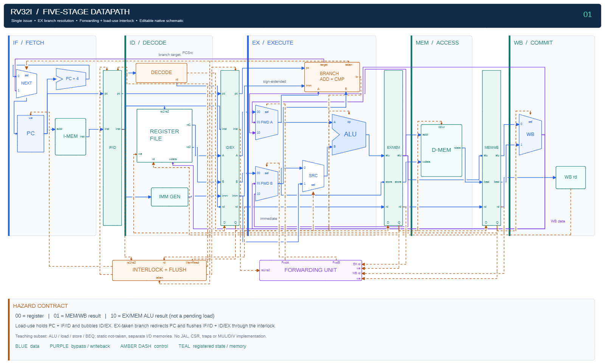
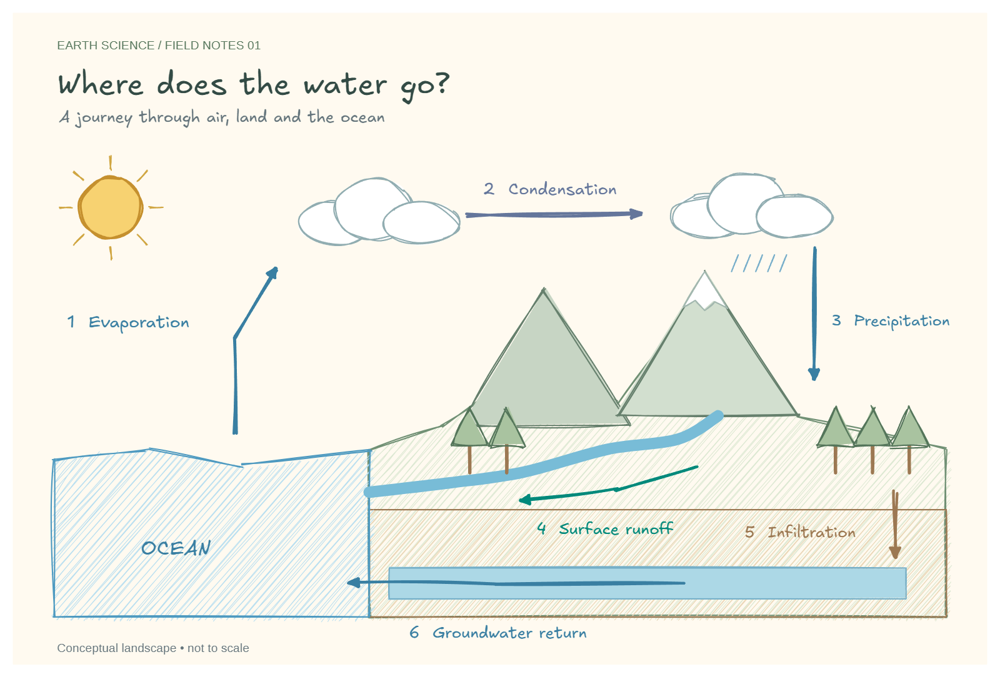
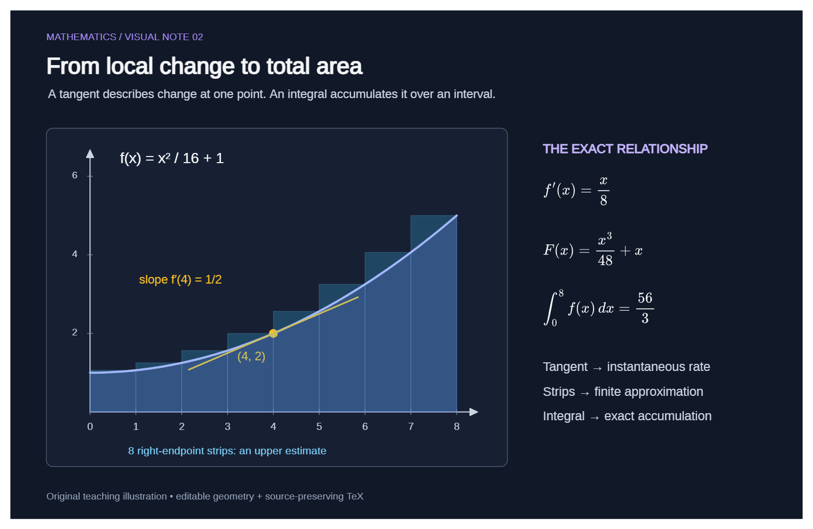
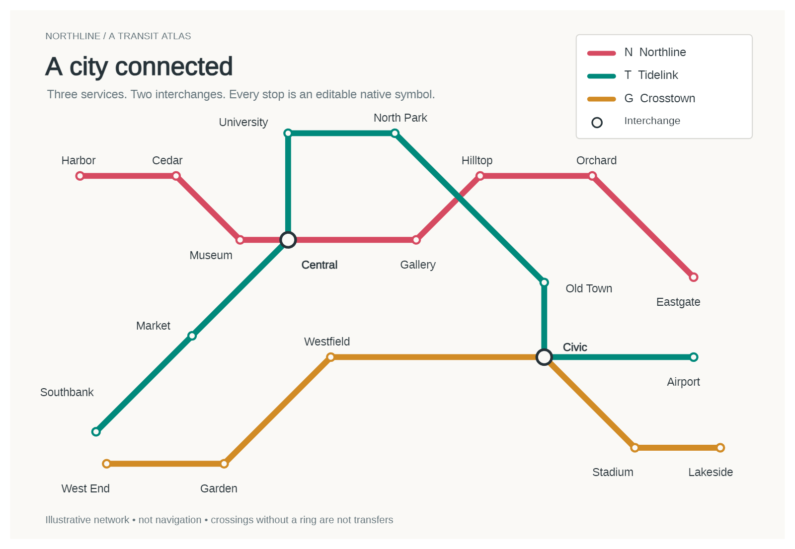
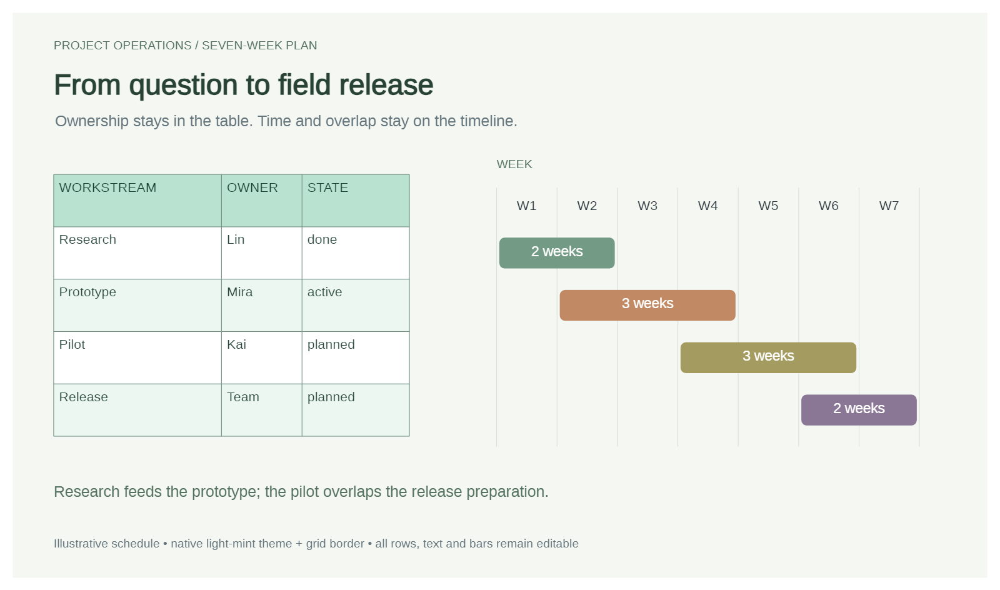
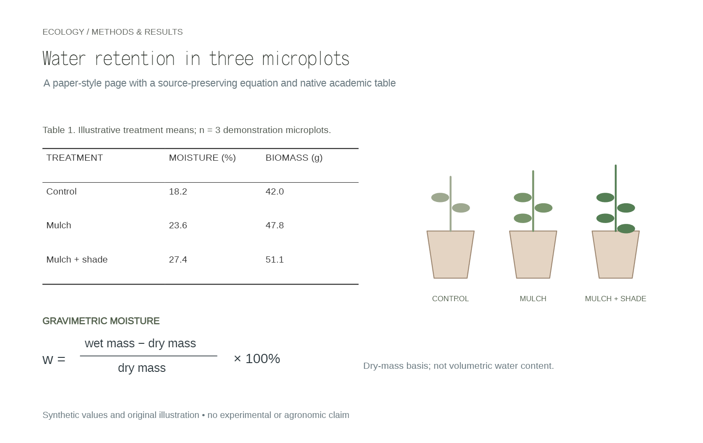
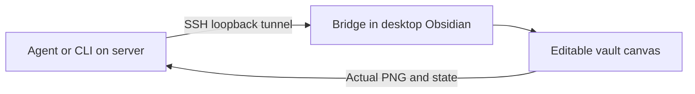

# Obsidian Excalidraw Agent

[English](README.md) · [简体中文](README.zh-CN.md)

**Describe a diagram, keep it editable, inspect the real result.** This package combines an Agent Skill, native drawing MCP/CLI, an optional YAML/JSON scene DSL, and the Bridge/Engines for **Obsidian Excalidraw-ymjr**.

Use Claude Code, Codex, OMP or another Skill/MCP-capable Agent. Or run the CLI without an LLM. **All execution paths still need a real desktop Obsidian host with the modified plugin; this is not an offline PNG generator.**

[Quick start](#quick-start) · [Choose a workflow](#choose-a-workflow) · [DSL](#repeatable-scenes-with-the-dsl) · [Gallery and sources](docs/gallery.md) · [Full DSL contract](docs/scene-dsl.md)

## See what it produces

These are actual Obsidian PNG exports of the included sources, not UI mockups. The editable canvas remains the deliverable; PNG is its visual-review artifact.

### Five-stage RISC-V datapath



[Python/native-API source](examples/builders/advanced_showcase.py) · [Editable canvas](examples/native/pipeline.excalidraw.md) · [Readable EX detail](docs/images/pipeline-execute.png). Independent components and 68 declared connections; ALU/load/store/BEQ teaching subset, not a complete RV32I implementation or RTL simulator.

### Earth science · warm handwritten landscape



[Source](examples/builders/diverse_showcase.py) · [Editable canvas](examples/native/water_cycle.excalidraw.md). Native rough lines, hachure, layered mountains and a river—not another architecture-card diagram.

### Mathematics · dark geometric plate



[Source](examples/builders/diverse_showcase.py) · [Editable canvas](examples/native/calculus.excalidraw.md). Consistent function, tangent and integral; three real MathJax formulas with source TeX retained.

### Urban transport · schematic wayfinding



[Source](examples/builders/diverse_showcase.py) · [Editable canvas](examples/native/transit.excalidraw.md). Twenty station symbols, three services and two interchanges; an original imaginary network, not navigation data.

### Project operations · native table and Gantt



[Source](examples/builders/diverse_showcase.py) · [Editable canvas](examples/native/gantt.excalidraw.md). Uses the host's **light-mint theme + grid template**, not hand-painted simulated cells.

### Ecology · paper-style native three-line table



[Source](examples/builders/diverse_showcase.py) · [Editable canvas](examples/native/academic.excalidraw.md). Uses the host's **academic theme + three-line template**. All measurements are synthetic demonstration values.

**These six README figures are Agent-authored native drawings, not DSL output or screenshots pasted into a canvas.** The two new table examples require the **paired native-table development build**; installing this package does not upgrade your host plugin. Discover `nativeTable.callable`, then use [`drawing_table(create|style)`](skills/obsidian-excalidraw/references/table-native.md). Older hosts fail explicitly rather than simulating the feature. Other examples, including the six YAML/DSL scenes, remain in the [gallery](docs/gallery.md).

## Choose a workflow

| Your goal | Start here | Who authors what |
| --- | --- | --- |
| “Draw this idea” | Natural language + Skill + MCP | You describe intent; Agent selects graph/native/DSL expression and reviews PNG |
| Quick one-off node/edge graph | `drawing_compose(..., inspect=true)` | Agent submits an ordinary diagram; measured plan/apply/check/PNG are combined |
| Repeatable source-controlled scenes, nested regions, tables, named ports | `drawing_dsl` or `launcher.py dsl` | Agent or human authors a compact scene; compiler reconciles stable identities |
| Rename/move/reconnect a precise part of an existing drawing | `drawing_read` → `drawing_apply` | Agent targets actual IDs/revision and preserves unrelated content |
| Native table themes and border templates | `drawing_table(create|style)` after `nativeTable.callable` discovery | Host TableManager owns semantic cells, themes, borders and reflow; paired development build required |
| Libraries, frames/presentations, interaction, navigation, animation | Existing native MCP tools and focused Skill references | Use real host capabilities, not a forced DSL approximation |
| Scripts, batch work, CI-side orchestration | `launcher.py cli` / `launcher.py dsl` | No LLM/MCP client required, but a connected GUI host is still required |
| Agent on a headless development server | Same tools through an SSH loopback tunnel | Server reasons; desktop host owns vault/fonts/assets and rendering |
| PNG looks wrong and normal state/checks do not explain why | Optional `drawing_debug(status|inspect)` | User enables read-only CDP; observe native state, then fine-tune through normal authorized APIs—not CDP |

The **Skill is guidance**, **MCP/CLI are execution interfaces**, **DSL is an optional compiler**, and **Obsidian/its native APIs render and store the drawing**. Installing only the Skill does not create a connection. The scene DSL and ordinary `drawing_compose` diagram schemas are intentionally different.

## Quick start

### 1. Prerequisites

- Obsidian Desktop with [Excalidraw-ymjr](https://github.com/Bowen-0x00/obsidian-excalidraw-plugin-ymjr) enabled in the intended vault. Upstream Excalidraw alone is not equivalent.
- [uv](https://docs.astral.sh/uv/getting-started/installation/) and Python 3.11+.
- For natural-language use: an Agent that loads Skills/calls stdio MCP. Actual visual approval also needs an image-capable model/client.
- [Advanced URI](https://github.com/Vinzent03/obsidian-advanced-uri) is optional for automatic startup. LaTeX needs the host's compatible Extras MathJax component.

### 2. Install one package

**Claude Code / Codex / other clients:**

```sh
git clone https://github.com/Bowen-0x00/obsidian-excalidraw-agent-skill.git
```

In the repository directory:

```sh
uv sync --frozen
```

Copy the **whole** `skills/obsidian-excalidraw/` directory, including references/prompts:

| Client | User-level Skill directory |
| --- | --- |
| Claude Code | `~/.claude/skills/obsidian-excalidraw/` |
| Codex | `~/.agents/skills/obsidian-excalidraw/` |

Register the same MCP server with the actual absolute package path:

```sh
claude mcp add --transport stdio --scope user excalidraw -- uv run --frozen --project "/absolute/path/to/package" python "/absolute/path/to/package/launcher.py" serve
codex mcp add excalidraw -- uv run --frozen --project "/absolute/path/to/package" python "/absolute/path/to/package/launcher.py" serve
```

Choose the command for your client, not both. Windows paths may use `D:/...`. Other clients use the same stdio launch command. See [Agent setup](skills/obsidian-excalidraw/references/agent-setup.md) for configuration details.

**OMP installation example:**

```sh
omp plugin marketplace add Bowen-0x00/obsidian-excalidraw-agent-skill
omp plugin install --scope user obsidian-excalidraw-agent-skill@obsidian-excalidraw-agent
```

Restart/reload the client and confirm tools appear. OMP is an example, not a dependency. Its `skill://...` URI is client-specific; other Agents read local Skill files.

### 3. Connect the intended vault

Keep Obsidian open. Ask your Agent to connect the chosen vault through `drawing_setup`, or run from the package directory:

```sh
uv run --frozen python launcher.py connect --vault "/absolute/path/to/vault"
uv run --frozen python launcher.py doctor
```

Setup deploys reviewed scripts into `Agent-Drawing/` under the plugin's configured drawing-script directory. It does not change plugin trust/autorun permissions. Without automatic startup, open a drawing and run `Agent-Drawing/mcp/Start-Agent-Drawing` in Obsidian; reload Obsidian if new commands are not indexed.

Existing installations must use their existing private state directory, selected by `EXCALIDRAW_AGENT_STATE_DIR`, rather than accidentally configuring a second connection. `launcher.py status` reports the selected directory and target without exposing a bearer token.

Starting the Agent inside another vault does **not** switch its user-level Bridge connection. Check `vault_path` first. `configured:true` is not proof of a live service; if Advanced URI is unavailable, run the stated bootstrap manually. Never bypass a managed-script conflict by rewriting installation ownership or searching session history for tokens. Long-lived clients follow updated private connection settings on their next request; reload an older MCP process once to load this fix. [Connection troubleshooting](skills/obsidian-excalidraw/references/agent-setup.md).

## Natural-language drawing

Ordinary requests do not need DSL knowledge:

> Draw a release flow: submit a change, check review/tests/rollback plan; approved goes to canary release, rejected goes to revision and resubmission. Keep all labels and inspect the PNG.

> Draw an asynchronous task platform with ingress, workers and persistence as separate regions. Keep status-query and progress-update paths distinguishable.

> Draw a Tomasulo teaching diagram with separate queue, Qi register table, reservation-station fields, execution units and named CDB ports—not stage bullet cards.

> Rename one node in the exact existing canvas I specify. Leave other content and styles alone.

Before a new drawing, the Agent asks unresolved **style and review depth** first, together with palette, background and font intent in one round. A recommendation is not a user answer; “retry/continue/draw this” does not waive questions. Explicit choices, deliberate inheritance and an explicit request to use defaults are recorded per field in a required `brief`. Its user requirements are checked individually at review. See the [choice/brief format](skills/obsidian-excalidraw/references/diagram-recipes.md) and [review evidence](skills/obsidian-excalidraw/references/acceptance.md). Hardware remains component/port/signal based; a kind string or swimlane is not a hardware router.

## Repeatable scenes with the DSL

The compiler is included—no separate repository, backend path or language server is required. CLI examples:

```sh
uv run --frozen python launcher.py dsl -- fonts
uv run --frozen python launcher.py dsl -- render examples/dsl/release-flow.yaml --font "EXACT_HOST_FAMILY" --brief-file ./drawing-brief.json --state-id release-demo --filename "Release-Demo-Unique" --output ./output/release.json
```

Replace `EXACT_HOST_FAMILY` with a current discovered family. The command creates native elements plus `release.json`/`release.png` on the client. Edit YAML and render again with the **same state-id**; the original IDs are updated, not a second graph appended. Omit filename afterward. Identical input is a no-op. Do not delete state or switch to compose to bypass a conflict.

Create `drawing-brief.json` from the cited choices and requirements using the linked format before the first render; do not copy fabricated user answers from an example. CLI authoring uses the same gate as MCP. Bind an existing canvas with its brief before a first write; read-only discovery/read/measurement remain available without it. Rebind preserves task/file review history. Bridge 0.13.7 rejects unknown/misplaced operation fields before any batch element is committed; native font/size/line-height measurement uses the same host path as text creation.


MCP Agents use the new **`drawing_dsl(action, document, font_family, state_id, ...)`** with a parsed JSON scene object. First render needs a unique filename or explicit existing file_path; read-only plan needs existing state/file_path for native measurements. Render returns checked PNG ImageContent, not visual approval. The same compiler serves CLI and MCP.

Read [the full DSL guide](docs/scene-dsl.md) for source syntax, JSON/MCP examples, read-only planning, resource inputs, update limits, private state and actual review commands. DSL covers measured spatial scenes; libraries, interaction, animation, arbitrary extensions and exact unmanaged edits remain available through native tools. Native GUI changes to managed content are conflicts, not silently merged back into source.

## Precise native editing and automation

The existing MCP tools remain: context/read/measure/plan/apply/check/preview/review/revert, compose, templates, primitives, library and present. The package CLI exposes the same client:

```sh
uv run --frozen python launcher.py cli -- context --action bind --file-path "Agent-Diagrams/existing.excalidraw.md"
uv run --frozen python launcher.py cli -- read --context-token "RETURNED_CONTEXT_TOKEN" --detail full
uv run --frozen python launcher.py cli -- --help
```

Use actual returned IDs/revision for apply, then check/preview/view/review. The plugin's own `obsidian ...:...` native CLI is a **different interface**; read its current help/schema and [native CLI reference](skills/obsidian-excalidraw/references/native-cli.md) before using it. A remote process cannot assume it has the graphical host's executable or paths.

## What remains editable—and what is checked

- Native shapes, text, arrows, bindings, groups/frames where used, SVG-path carriers and source-backed resources—not a flattened diagram image.
- DSL tables are sharp-cell native shapes with bound text and contrasting headers; not a claim of new Table Engine interaction features. DSL `groups` are visible layout regions, not automatic native groups/frames.
- ECharts 1.3.0 supports multi-series/stacked/dual-axis/XY and other visual forms; its 16 showcase cases are 12 base forms plus custom/variants. Advanced DSL/MCP charts retain options through `custom`; GUI form roundtrip and JSON roundtrip are distinct.
- Checks cover structure, explicit semantic assertions, geometry and visible-text risks. Current PNG inspection still decides real readability, occlusion, routing and hierarchy. A passing check alone is not professional-quality proof.
- Acceptance **low / medium (default) / high** is independent of model effort. Medium requires actual content/readability/occlusion observations; high also checks connections/hierarchy/style. Not every legal arrow must bind.
- Font discovery is not glyph/fallback proof. Export completeness is not interaction proof. Hover, collapse, navigation, dataZoom and animation require live actions and observations.

Images, formulas, custom effects and interactions depend on installed host resources. Unknown geometry and unavailable capabilities are reported, not replaced by fake images or silently deleted content.

## Headless server, graphical host



No server GUI or X11 is needed. The desktop owns fonts/assets/renderer. Host vault paths, client output paths and private state are separate. `remote-deploy` is an OMP registration convenience; other clients can launch the same remote stdio runtime. Full instructions: [Agent setup](skills/obsidian-excalidraw/references/agent-setup.md).

## Optional read-only CDP troubleshooting

**Off by default.** If a drawing looks wrong and Bridge/PNG feedback cannot explain the cause, the Agent can offer deeper state diagnostics: paint order, displayed/source text, bindings, native tables, image references, canvas/viewport and renderer error counts.

The user chooses whether to enable it. Against an already-running, explicitly selected Obsidian debugging instance:

```sh
uv run --frozen python launcher.py cdp -- status
uv run --frozen python launcher.py cdp -- enable --endpoint http://127.0.0.1:19223 --vault-path "/absolute/HOST/vault"
uv run --frozen python launcher.py cdp -- inspect --file "Drawings/Example.excalidraw.md"
uv run --frozen python launcher.py cdp -- disable
```

Replace the example port/path with the host's actual endpoint and vault. Obsidian must have been started explicitly with `--remote-debugging-port=PORT`; this tool never starts/restarts it. Prefer a separate profile **and** a disposable vault for development. Remote clients need a separately authorized SSH tunnel; the normal Bridge tunnel does not expose CDP.

MCP exposes only **`drawing_debug(status|inspect)`**, no enable action or arbitrary JS. The selected file must already be open; the tool does not open, focus, click, drag, pause, save, export, reload plugins or modify drawings. Fixed queries use V8 side-effect checks and fail closed—never retry without the guard. Private opt-in is scoped to this client state directory and is not auto-enabled on remote installations.

**Fine-tuning remains a normal authorized Bridge/API or DSL edit**, using a fresh revision and final PNG/review. Diagnostics alone do not authorize repair. CDP itself is powerful and not a sandbox: the read-only restriction applies to this package's guarded inspector, not other debugging clients. Do not expose the debugging port publicly or use raw browser/evaluate tools to bypass it. [Full safety and debug workflow](skills/obsidian-excalidraw/references/cdp-readonly.md).

## Read only the relevant guide

| Topic | Guide |
| --- | --- |
| Actual example images, sources, complexity and limits | [Gallery](docs/gallery.md) |
| YAML/JSON schema, MCP/CLI, incremental state and review | [Scene DSL](docs/scene-dsl.md) |
| Images, formulas, extensions, tables, special diagrams | [Capability map](skills/obsidian-excalidraw/references/capability-map.md) |
| Library discovery and description-only maintenance | [Libraries](skills/obsidian-excalidraw/references/library-catalog.md) · [curation prompt](skills/obsidian-excalidraw/prompts/maintain-libraries.zh-CN.md) |
| Hardware symbols/ports/signals and saved-route audit | [Microarchitecture](skills/obsidian-excalidraw/references/microarchitecture.md) |
| Style choices, actual fonts and visual acceptance | [Styles](skills/obsidian-excalidraw/references/diagram-recipes.md) · [Typography](skills/obsidian-excalidraw/references/typography.md) · [Acceptance](skills/obsidian-excalidraw/references/acceptance.md) |
| Trusted scripts, native CLI and live interaction | [Scripts](skills/obsidian-excalidraw/references/script-execution.md) · [Native CLI](skills/obsidian-excalidraw/references/native-cli.md) |
| Read-only CDP switch, diagnostics and safe fine-tuning | [CDP troubleshooting](skills/obsidian-excalidraw/references/cdp-readonly.md) |
| Shared Engine source synchronization and release checks | [Maintenance](docs/maintenance.md) |
| Comparison with other diagramming approaches | [next-ai-draw-io](skills/obsidian-excalidraw/references/next-ai-draw-io.md) |

User `.excalidrawlib` assets are not redistributed here. Query the actual current item IDs/previews; changing your library does not require a Skill upgrade. Native `professional/visio/handdrawn/blueprint/presentation` profiles are not exported `.vsdx`/`.pptx` formats or bitmap filters. Freehand strokes and Rough.js styling are different capabilities.

## Updates and safety

For a checkout: stop this package's MCP process, pull, `uv sync --frozen`, refresh copied Skill files and restart MCP. For OMP, follow the supported marketplace update/plugin upgrade instructions in Agent setup; disconnect the old MCP first on Windows to avoid locked-cache failures. Reconnect the **same vault** to update managed scripts, preserving customized-file conflict checks; reload Engines/Obsidian when needed. Preserve private connection settings, DSL identity state and review artifacts.

**0.10.0 migration:** update/reconnect each configured vault's managed bundle, then run its `Agent-Drawing/mcp/Start-Agent-Drawing` and reload MCP. Both bootstrap and Bridge must report **0.13.7**; updating only the Skill does not replace a running host. New artwork asks unresolved style/review first and passes a resolved `brief`; native reviews additionally cover every user requirement. The fixed installation diagnostic is `launcher.py smoke --font "EXACT_DISCOVERED_FAMILY" --filename Unique-Smoke`. Existing private state is retained; backups/old package snapshots are not rewritten.


The Bridge is trusted local code with vault read/write access, **not a sandbox**. It listens on loopback and authenticates requests. Keep credentials out of prompts, scenes, public reports and Git. Code-bearing customData/library scripts, external writes and additional Engines are not automatically trusted because you asked for a diagram. The model provider receives the prompts/images it processes.

Original package code and authored examples are [MIT licensed](LICENSE); embedded libraries retain their [third-party licenses](THIRD_PARTY_NOTICES.md). Not affiliated with Obsidian or upstream Excalidraw. [Changelog](CHANGELOG.md).
