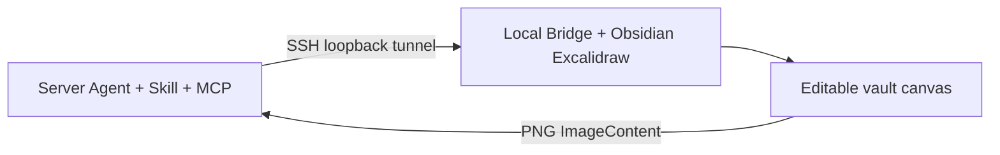

# Obsidian Excalidraw Agent

[English](README.md) · [简体中文](README.zh-CN.md)

Create and edit diagrams in **Obsidian Excalidraw-ymjr** from natural-language requests, then inspect real PNGs and refine the result.

**Use with Claude Code, Codex, OMP, or another Agent that can load Skills and call MCP tools. OMP is one installation example—not a required dependency.**

## What it does

- Flowcharts, architecture diagrams, UML, swimlanes, mindmaps, circuits, waveforms and editable presentation pages.
- Web images, formulas and your own libraries; reusable components built from SVG paths.
- Mixed prose/math is explicitly rendered, not left as `$...$` source in labels: reuse the host Extract-Latex Action or native text+LaTeX composition, then verify source TeX, layout, stacking and relationships. See the [inline formula workflow](skills/obsidian-excalidraw/references/visual-content.md).
- Visual effects, interaction and navigation supplied by the modified plugin and its drawing scripts. Availability depends on the installed host capabilities.
- New drawings collect unspecified visual preferences once through the Agent client's selection UI: style, palette/color limits, light/dark background, color versus grayscale, installed fonts and heading weight. Explicit choices/local edits are preserved. Semantic arrowheads and fixed small corner radii are set as native properties; see [visual choices](skills/obsidian-excalidraw/references/diagram-recipes.md) and [arrows/corners](skills/obsidian-excalidraw/references/layout-export-animation.md).
- Native Visio-style line crossings in updated hosts: jump arcs, background-independent gaps and junction dots. Use native metadata rather than white masking rectangles; see the [layout and crossing reference](skills/obsidian-excalidraw/references/layout-export-animation.md).
- Measured text, layout planning, relationship/geometry checks, PNG inspection and targeted edits that preserve unrelated content; native common-center group rotation and proportional selection scaling.
- Size library assets for their intended use before filling text or wiring: fit the whole slide template or circuit instance, including its anchor. Distinguish single-element resize from native selection scaling and PNG export scale. Remote PNG bytes can use existing data:image inputs alongside native text/frames; see [sizing](skills/obsidian-excalidraw/references/layout-export-animation.md) and [images](skills/obsidian-excalidraw/references/images-assets.md).
- Concurrent Agents on separate token-bound canvases, with serialized native execution and stale-write protection. Every PNG includes the same-revision compact element summary and scene min/max bounds; feedback coordinates use at most two decimals without changing native precision.
- Lower-round-trip execution: ordinary graphs use existing `drawing_compose` for measured plan→apply without copying operations through the model. `inspect:true` on compose/apply adds full checks and the registered PNG ImageContent in one call; visual review and fresh revision guards remain mandatory. Advanced workflows stay available through the compact Skill's references.
- Hardware requests take an explicit component/port/signal/stage-planning route, not the service-graph shortcut. Preserve ALU/RF/MUX/queue/array structure, route control/feedback networks deliberately, and reject check-passing stage bullet lists as microarchitecture. See the [hardware workflow](skills/obsidian-excalidraw/references/microarchitecture.md).
- The hardware Skill records a staged production/repair loop and a separate saved-segment orthogonality audit. Prefer axis-aligned links; choose explicit polylines or native elbows according to actual port behavior, not flags alone. This is workflow guidance, not a new hardware auto-router or a built-in `drawing_check` assertion.
- Font choice is host-discovered, evidence-bounded and text-role based, not a fixed installed-font catalogue. The Agent evaluates current families, selects prose/code/label/annotation roles, measures with explicit families and verifies actual PNGs; discovery alone does not prove glyph coverage or absence of fallback. See [typography](skills/obsidian-excalidraw/references/typography.md). Bridge 0.13.4 exposes native `getFontFamilies()` results with provenance/errors through existing discovery.
- Size PowerPoint-style filled/outline block arrows for flow, architecture, teaching and comparison diagrams—not just slides. Control path length, native `customData.blockArrowWidth`, head scale and outline stroke separately; use short/wide or long/slim proportions, preserve bindings during width-only edits, and inspect the full rendered envelope. Bridge 0.13.5 exposes both `block_arrow` and `block_arrow_outline`; see [arrow sizing](skills/obsidian-excalidraw/references/layout-export-animation.md).

## Editable diagrams, multiple styles, remote development

The result remains native Excalidraw shapes, text, arrows, groups, frames, bindings and SVG-path carriers. PNGs are review artifacts, not replacements for the canvas. You can drag, rename, reconnect and restyle elements in Obsidian.

| Style | Behavior |
| --- | --- |
| `professional` | Clean, restrained document diagrams |
| `visio` | Sharp edges, explicit partitions and engineering connectors |
| `handdrawn` / `roughjs` | Native Rough.js roughness and hachure, not a bitmap filter |
| `blueprint` | White background with blue engineering lines |
| `presentation` | Larger type and stronger hierarchy |
| Native freehand (`draw` / `freedraw`) | Editable point/pressure strokes for handdraw whiteboard requests; distinct from a Rough.js profile |

Hand-drawn styling and freehand strokes are different: `handdrawn` is a rendering profile; draw/handdraw whiteboard requests can use native `freedraw` elements. Visio styling does not imply `.vsdx` export.

An Agent working on a development server can use this Skill and MCP while the actual diagram is created in desktop Obsidian:



The server reasons and calls tools; the local host owns the vault, plugin, fonts, assets and rendering. No server-side GUI or X11 is required. Host paths are not remote paths, and the current convenience `remote-deploy` registration is OMP-specific; other clients register the same remote stdio runtime as described in [Agent setup](skills/obsidian-excalidraw/references/agent-setup.md).

See [next-ai-draw-io comparison](skills/obsidian-excalidraw/references/next-ai-draw-io.md) for useful canvas-first, edit-gate, snapshot and screenshot-validation ideas.
See [Showcase and GIF guide](skills/obsidian-excalidraw/references/showcase.md) for reproducible prompts and the real native-canvas → PNG → local-repair workflow.

The package has three parts: the **Skill** describes the workflow; the **MCP server** exposes operations; **Obsidian drawing scripts** construct elements, manage extensions and render them. Installing only the Skill does not provide an execution connection.

## Before you start

You need:

1. Obsidian Desktop with [Excalidraw-ymjr](https://github.com/Bowen-0x00/obsidian-excalidraw-plugin-ymjr) installed and enabled in the target vault. This integration depends on the modified plugin, not just upstream Excalidraw.
2. An Agent with Skill support and local stdio MCP. Visual review also requires a model and client that can inspect images.
3. [uv](https://docs.astral.sh/uv/getting-started/installation/) and Python 3.11+ for this package's MCP server.

[Advanced URI](https://github.com/Vinzent03/obsidian-advanced-uri) is optional: it enables automatic Bridge startup. Without it, run the startup script manually in Obsidian. LaTeX additionally requires a compatible Excalidraw Extras MathJax component.

## 1. Install the Skill and MCP

Choose one path for your Agent.

### Claude Code / Codex

Clone this repository, then install dependencies from its directory:

```sh
git clone https://github.com/Bowen-0x00/obsidian-excalidraw-agent-skill.git
```

```sh
uv sync --frozen
```

Copy the **entire** `skills/obsidian-excalidraw/` directory to the appropriate location, preserving its references and prompts:

| Agent | User-level Skill directory | Invocation example |
| --- | --- | --- |
| Claude Code | `~/.claude/skills/obsidian-excalidraw/` | `/obsidian-excalidraw` |
| Codex | `~/.agents/skills/obsidian-excalidraw/` | `$obsidian-excalidraw` |

Register the same MCP server. Replace `/absolute/path/to/package` with the actual repository path; Windows paths can use `D:/...`.

**Claude Code:**

```sh
claude mcp add --transport stdio --scope user excalidraw -- uv run --frozen --project "/absolute/path/to/package" python "/absolute/path/to/package/launcher.py" serve
```

**Codex:**

```sh
codex mcp add excalidraw -- uv run --frozen --project "/absolute/path/to/package" python "/absolute/path/to/package/launcher.py" serve
```

Restart the Agent and check its MCP panel. This path uses standard Skill files and MCP; other clients can configure the same launch command. See [Agent setup](skills/obsidian-excalidraw/references/agent-setup.md) for configuration details and official client documentation.

### OMP example

```sh
omp plugin marketplace add Bowen-0x00/obsidian-excalidraw-agent-skill
omp plugin install --scope user obsidian-excalidraw-agent-skill@obsidian-excalidraw-agent
```

This installs the Skill and registers the packaged MCP. Restart OMP or run `/reload-plugins`; check `/mcp list`. OMP's `skill://obsidian-excalidraw` is a client-specific access route. Other Agents read the installed Skill file and its relative references directly.

## 2. Connect Obsidian

Keep Obsidian open and ask your Agent:

> Use the obsidian-excalidraw Skill, connect to my chosen Obsidian vault, and check the drawing service.

The Agent uses `drawing_setup` to discover vaults, deploy the required scripts and connect. Scripts go into `Agent-Drawing/` under the plugin's configured **drawing script directory**. No fixed directory name is required, and setup does not change plugin enablement permissions.

If automatic startup fails, open a drawing and run this command in Obsidian:

```text
Agent-Drawing/mcp/Start-Agent-Drawing
```

Reload Obsidian if newly installed scripts are not indexed. From the repository, `uv run --frozen python launcher.py status` checks status; `launcher.py connect --vault "actual vault path"` connects explicitly. Full commands are in the setup reference.

## 3. Describe the diagram and inspect the result

For example:

> Draw a request-review flowchart: submit → review; approved → issue credentials, rejected → explain why; both paths end. Keep every label and inspect the PNG.

> Choose MUX, ALU and Register File symbols from my circuit library and draw a data path. Preserve the original symbols and editable connections.

> Rename one node in the drawing I specify, leaving other content and styles unchanged.

Editable drawings stay in the connected vault. PNGs and review records are stored in the MCP server's data directory. The Agent reads the canvas, checks constraints, inspects a fresh PNG and repairs specific issues. Reviews stop when the result passes or after five rounds, with unresolved problems reported explicitly.

**A correct PNG does not prove interaction works.** Hover, collapse, zoom navigation and animation require actions and observations in the live canvas.

## Using and updating your libraries

`.excalidrawlib` files are user assets. **They are not copied into the Skill or distributed with this package.** The Agent queries the current library, checks item IDs/content/previews, then inserts native elements.

- Add, remove or edit library items: no Skill upgrade is needed; query the current library again.
- Maintain item `description` or `library-index.md`: refresh that user metadata after library changes. Old summaries are not a substitute for the actual items.
- Change rendering, asset formats or API contracts: update the Skill or execution adapter when necessary.

To ask an Agent to curate descriptions and summaries, copy [the library maintenance prompt](skills/obsidian-excalidraw/prompts/maintain-libraries.zh-CN.md), then append your library paths and notes. It preserves elements, assets, IDs and human annotations, changing descriptions only within your authorization. See [Library guide](skills/obsidian-excalidraw/references/library-catalog.md).

## Read only what you need

| Topic | Reference |
| --- | --- |
| Images, SVG components, mindmaps, waveforms, interaction and animation | [Capability map](skills/obsidian-excalidraw/references/capability-map.md) |
| Claude Code / Codex / OMP setup, remote drawing, state directories and updates | [Agent setup](skills/obsidian-excalidraw/references/agent-setup.md) |
| Develop drawing scripts, run them through URI and inspect PNGs | [Script execution](skills/obsidian-excalidraw/references/script-execution.md) |
| The plugin's native CLI, distinct from this package's MCP | [Native CLI](skills/obsidian-excalidraw/references/native-cli.md) |
| next-ai-draw-io reference and reusable ideas | [Comparison](skills/obsidian-excalidraw/references/next-ai-draw-io.md) |
| Release changes | [Changelog](CHANGELOG.md) |

## Updates and safety

For a checkout, use `git pull` and `uv sync --frozen`, refresh copied Skill files, then restart MCP. For OMP, use marketplace update / plugin upgrade as documented in Agent setup. Reconnect the **same vault** after package updates to update managed host scripts. Customized files are not silently overwritten.

### Shared Engine source and automatic update PRs

- [`bridge/shared-scripts.json`](bridge/shared-scripts.json) is the explicit import allowlist. Shared Engines are maintained only in [Scripts](https://github.com/Bowen-0x00/obsidian-excalidraw-scripts); `mcp/Start-Agent-Drawing.md` and `mcp/Engine-Agent-Bridge.md` belong to this Agent repository and are never imported.
- [`bridge/shared-scripts.lock.json`](bridge/shared-scripts.lock.json) records the exact source commit, each source path, script version and SHA-256 of UTF-8/LF content. The initial legacy baseline has `sourceCommit: null` because historical provenance is unknown, not fabricated; the first actual update pins the complete imported snapshot.
- Scripts `main` pushes notify this repository only for declared inputs (or notification workflow changes). The receiving [workflow](.github/workflows/sync-shared-scripts.yml) also supports **Run workflow** and a six-hour fallback. It imports the latest source `main` commit, coalescing delayed notifications, validates the complete input, compiles Engine JavaScript without executing it, runs importer and runtime regressions, then creates/updates **one** `automation/shared-script-engines` PR.
- Unrelated source changes and identical content are no-ops, including no lock commit churn or rewriting an already-current open PR. Deleted/renamed inputs, missing declarations, symlinks and independently edited shared copies fail visibly before copying. A bot branch containing human commits or out-of-scope files is not overwritten; a rejected/orphaned sync branch must be resolved/deleted before rerunning. An unchanged branch from a merged PR can be reused for the next update.
- Configure `SKILL_SYNC_TOKEN` as an **Actions repository secret in both repositories**. Prefer a dedicated expiring fine-grained token limited to this Agent repository with **Contents: read/write**, **Pull requests: read/write**, and Metadata read; source scripts are public. It dispatches from Scripts and creates the target bot PR (so integrity CI runs normally). Never paste the token into workflow YAML, commit it, or enable secret-bearing jobs on untrusted PRs. Rotate by replacing both secrets. Repository-wide default workflow permissions need not be broadened.
- PR creation is automatic; merging/releasing remains a maintainer gate. Exercise affected Hooks/APIs and real Obsidian interaction/PNG output before release. GitHub runners cannot prove GUI compatibility. The PR does not bump package versions, overwrite customized vault files, reload an already registered Engine, or deploy to local/remote clients.

Local maintenance (the source checkout must contain the exact published commit):

```sh
python scripts/sync_shared_scripts.py check
python scripts/sync_shared_scripts.py plan --source-dir /path/to/scripts --source-commit FULL_40_CHARACTER_COMMIT
python scripts/sync_shared_scripts.py apply --source-dir /path/to/scripts --source-commit FULL_40_CHARACTER_COMMIT
node scripts/check_shared_scripts.mjs
python -m unittest discover -s scripts/tests -v
uv run --frozen python -m unittest discover -s runtime/tests -v
```

To add an Engine, explicitly review the manifest, lock entry and `bridge/bundle.json` together; never auto-import every new script by matching filenames. Return shared code fixes upstream instead of editing the bundled copy independently.

The Bridge is trusted local code with vault read/write access, not a sandbox. It listens on loopback and authenticates requests. Keep private connection files out of public repositories; executable library data requires explicit trust. Anki/Eagle writes, additional Engines and animation are not default side effects of PNG export. Your model provider receives the prompts and images it processes.

Original package code is [MIT licensed](LICENSE); embedded libraries retain their [third-party licenses](THIRD_PARTY_NOTICES.md). This project is not affiliated with Obsidian or upstream Excalidraw.
