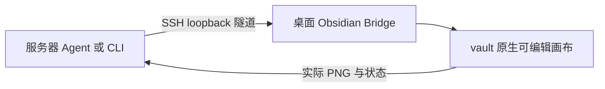

# Obsidian Excalidraw Agent

[English](README.md) · [简体中文](README.zh-CN.md)

**用自然语言描述，得到可继续编辑的图，再查看真实结果。** 本包包含 Agent Skill、原生绘图 MCP／CLI、可选 YAML／JSON 场景 DSL，以及连接 **Obsidian Excalidraw-ymjr** 的 Bridge／Engines。

支持 Claude Code、Codex、OMP 等 Skill／MCP 客户端，也可不经 LLM 直接运行 CLI。**所有执行路径仍需真实的桌面 Obsidian 和修改版插件；不是离线图片生成器。**

[快速开始](#快速开始) · [选择使用方式](#选择使用方式) · [DSL](#用-dsl-维护可重复生成的图) · [完整画廊与源码](docs/gallery.md) · [DSL 详细规范](docs/scene-dsl.md)

## 先看实际效果

下面都是附带源码在真实 Obsidian 中导出的 PNG，不是 UI 效果图。交付物仍是可编辑画布，PNG 用于视觉检查。

### 五级 RISC-V 数据通路


[Python／原生 API 源码](examples/builders/advanced_showcase.py) · [可编辑画布](examples/native/pipeline.excalidraw.md) · [EX 局部大图](docs/images/pipeline-execute.png)。独立部件、命名端口和 68 条声明连接；覆盖 ALU／load／store／BEQ 教学子集，不冒充完整 RV32I 实现或 RTL 仿真。

### 分布式推理：从请求接入到 Token 交付


[Python／原生 API 源码](examples/builders/advanced_showcase.py) · [可编辑画布](examples/native/inference.excalidraw.md)。展示 Prefill／Decode 分离、分页 KV 安装与读取、KV-ready 交接、逐 Token 循环、取消回收、背压和版本发布；是参考架构，不是实测部署。

### 分块矩阵加速器与数据复用


[Python／原生 API 源码](examples/builders/advanced_showcase.py) · [可编辑画布](examples/native/accelerator.excalidraw.md) · [PE 阵列局部大图](docs/images/accelerator-array.png)。16 个 MAC 单元，操作数向东／向南传递，计算时本地累加，结束后独立 drain。

**这三组复杂图由 Agent 编写 Python、调用已有原生 API 制作，不是 DSL 自动生成，也不是一键硬件自动布局的效果。** [画廊](docs/gallery.md) 标明源码、PNG 检查和能力边界；原来的六组 YAML／DSL 示例仍全部保留，包括原生表格／ECharts、长中文分支、Tomasulo 和图片／LaTeX 等效果。

## 选择使用方式

| 你的需求 | 推荐入口 | 谁来组织内容 |
| --- | --- | --- |
| “帮我画这个想法” | 自然语言＋Skill＋MCP | 用户说意图，Agent 选择普通图、DSL 或原生表达并看 PNG |
| 一次性的普通节点关系图 | `drawing_compose(..., inspect=true)` | Agent 提交普通 diagram，执行层合并测量、布局、提交、检查和导出 |
| 可版本管理、重复生成、嵌套区域、表格、多端口 | `drawing_dsl` 或 `launcher.py dsl` | Agent 或人编写精简场景，编译器按稳定身份增量更新 |
| 已有图改字、移动、重连一小部分 | `drawing_read` → `drawing_apply` | 按真实 ID／revision 精确操作，保留无关内容 |
| 素材库、演示框架、交互、导航、动画等 | 原生 MCP＋对应 Skill 参考 | 使用真实宿主能力，不强塞进 DSL 或假装近似实现 |
| 自动化脚本、批量流程 | `launcher.py cli`／`launcher.py dsl` | 不要求 LLM 或 MCP 客户端，但仍要求已连接 GUI 宿主 |
| Agent 在无桌面的开发服务器 | 同一工具经 SSH loopback 隧道调用 | 服务器推理，本地桌面管理 vault、字体、素材与渲染 |

**Skill 是工作指导，MCP／CLI 是执行入口，DSL 是可选编译器，Obsidian 原生 API 负责实际构造、保存和渲染。** 只装 Skill 不会自动获得连接；DSL 的 document 也不能当成 drawing_compose 的 diagram。

## 快速开始

### 1. 准备环境

- Obsidian Desktop，目标 vault 已启用 [Excalidraw-ymjr](https://github.com/Bowen-0x00/obsidian-excalidraw-plugin-ymjr)。不能把上游 Excalidraw 当作等价环境。
- [uv](https://docs.astral.sh/uv/getting-started/installation/) 和 Python 3.11+。
- 自然语言路径需要支持 Skill／stdio MCP 的 Agent；要做视觉验收，还需可实际查看图片的模型和客户端。
- [Advanced URI](https://github.com/Vinzent03/obsidian-advanced-uri) 可选，用于自动启动；LaTeX 另需宿主兼容的 Extras MathJax 组件。

### 2. 安装同一个包

**Claude Code／Codex／其他客户端：**

```sh
git clone https://github.com/Bowen-0x00/obsidian-excalidraw-agent-skill.git
```

在仓库目录运行：

```sh
uv sync --frozen
```

复制 `skills/obsidian-excalidraw/` **整个目录**，保留 references 和 prompts：

| 客户端 | 用户级 Skill 目录 |
| --- | --- |
| Claude Code | `~/.claude/skills/obsidian-excalidraw/` |
| Codex | `~/.agents/skills/obsidian-excalidraw/` |

注册同一个 MCP 服务，把绝对路径换成真实安装目录：

```sh
claude mcp add --transport stdio --scope user excalidraw -- uv run --frozen --project "/absolute/path/to/package" python "/absolute/path/to/package/launcher.py" serve
codex mcp add excalidraw -- uv run --frozen --project "/absolute/path/to/package" python "/absolute/path/to/package/launcher.py" serve
```

按客户端选一条，不要两条都运行。Windows 路径可写成 `D:/...`。其他客户端使用相同 stdio 启动命令，详细配置见 [Agent 接入说明](skills/obsidian-excalidraw/references/agent-setup.md)。

**OMP 安装示例：**

```sh
omp plugin marketplace add Bowen-0x00/obsidian-excalidraw-agent-skill
omp plugin install --scope user obsidian-excalidraw-agent-skill@obsidian-excalidraw-agent
```

重启／reload 客户端并检查工具列表。OMP 不是必需依赖，其 `skill://...` 是客户端专有访问方式；其他 Agent 直接读取本地 Skill。

### 3. 连接明确的 vault

保持 Obsidian 打开，让 Agent 用 drawing_setup 连接你选择的 vault；或在包目录运行：

```sh
uv run --frozen python launcher.py connect --vault "/absolute/path/to/vault"
uv run --frozen python launcher.py doctor
```

脚本部署到插件配置的绘图脚本目录下的 `Agent-Drawing/`，不改变插件授信或 autorun 权限。不能自动启动时，先打开一个画布，再在 Obsidian 运行 `Agent-Drawing/mcp/Start-Agent-Drawing`；新命令尚未索引时重载 Obsidian。

已有安装继续使用原私有 state 目录，通过 `EXCALIDRAW_AGENT_STATE_DIR` 指定，避免意外配置第二条连接。`launcher.py status` 会说明当前目录和目标，不输出 bearer token。

## 自然语言绘图

普通用户不需要懂 DSL：

> 画变更上线流程：提交申请，检查评审、测试与回滚方案；通过后灰度发布，未通过则修订再提交。保留全文，检查 PNG。

> 画异步任务平台，分接入、执行、持久化三个区域。更新状态与查询进度的走线要容易区分。

> 画 Tomasulo 教学结构，要有独立指令队列、Qi 寄存器表、保留站字段、执行器和 CDB 命名端口，不要做成阶段说明卡片。

> 修改我指定的已有画布中的一个节点标签，其他内容和样式不变。

Agent 只询问会实质影响结果的缺失选择，发现当前字体／资源，选择入口，读回全图、检查、查看 PNG，再局部修复。硬件按部件／端口／信号规划；一个 kind 字段不是硬件自动布局器。

## 用 DSL 维护可重复生成的图

编译器随包提供，不另建安装，也不需要 `--backend` 指向另一份 runtime：

```sh
uv run --frozen python launcher.py dsl -- fonts
uv run --frozen python launcher.py dsl -- render examples/dsl/release-flow.yaml --font "EXACT_HOST_FAMILY" --state-id release-demo --filename "Release-Demo-Unique" --output ./output/release.json
```

`EXACT_HOST_FAMILY` 必须替换为当前发现的精确字体名。命令生成原生元素，以及客户端上的 `release.json`／`release.png`。修改 YAML 后复用**同一个 state-id**再次 render，更新原 ID，不追加第二张图；以后可省略 filename。相同源是零绘图操作。不能删 state 或改用 compose 整图重放绕过冲突。

MCP Agent 使用新增的 **`drawing_dsl(action, document, font_family, state_id, ...)`**，document 是同一场景的已解析 JSON 对象。首次 render 需要唯一 filename 或明确现有 file_path；只读 plan 需要已有 state／file_path 来真实测量文字。返回实际检查后的 PNG ImageContent，不会自动宣布视觉通过。CLI 与 MCP 共用一个编译执行实现。

[DSL 详细规范](docs/scene-dsl.md) 包含语法、JSON／MCP 示例、只读规划、资源、增量限制、私有状态和实际 review 命令。DSL 负责测量后的空间场景；素材库、交互、动画、任意扩展、非受管图的精确修改仍走原生路径。GUI 修改受管内容会触发冲突，不自动反向合并回 YAML。

## 原生精确编辑与自动化

原有工具全部保留：context/read/measure/plan/apply/check/preview/review/revert，以及 compose、templates、primitives、library、present。本包 CLI 使用相同绘图客户端：

```sh
uv run --frozen python launcher.py cli -- context --action bind --file-path "Agent-Diagrams/existing.excalidraw.md"
uv run --frozen python launcher.py cli -- read --context-token "RETURNED_CONTEXT_TOKEN" --detail full
uv run --frozen python launcher.py cli -- --help
```

用实际返回的 ID／revision 提交 apply，再 check／preview／看图／review。插件自身的 `obsidian ...:...` 原生 CLI 是**另一套接口**，先读其当前 help／schema 和 [原生 CLI 参考](skills/obsidian-excalidraw/references/native-cli.md)；远端不能假设有宿主可执行文件或直接访问宿主路径。

## 可编辑性与验收边界

- 输出保留原生形状、文字、箭头、绑定，以及实际使用的组／frame、SVG-path carrier、源资源，不是一张扁平化整图。
- DSL 表格是直角 cell＋绑定文字＋分层表头，不宣称新增 Table Engine 交互；DSL groups 是可见布局区域，不等于自动原生 group／frame。
- ECharts 1.3.0 覆盖多系列、堆叠、双轴、数值 XY 等；16 个示例是 12 种基础图型＋custom／变体。高级 DSL／MCP 图用 custom 保留完整 options，JSON 往返与可视表单数据模型往返不是同一承诺。
- 检查覆盖结构、显式语义断言、几何和文字可读风险；真实 PNG 仍需判断内容、遮挡、走线与层级。check=pass 不是专业质量的自动证明。
- 验收 **low／medium（默认）／high** 与模型 effort 无关。medium 记录实际内容／可读／遮挡观察；high 再核对连接与层级风格，不强制所有合法独立箭头绑定。
- 字体被发现不等于每字无 fallback；资源完整不等于交互通过。hover、折叠、导航、dataZoom 和动画需要在真实界面触发观察。

图片、公式、扩展效果和交互取决于宿主资源。缺能力或几何 unknown 会明确报告，不用假图片或删除内容掩盖。

## 服务器开发，本地渲染



服务器不需要 GUI／X11；本地桌面负责字体、素材和渲染。宿主 vault 路径、客户端输出路径、私有 state 分开理解。remote-deploy 是面向 OMP 的便捷注册；其他客户端可启动同一远端 stdio runtime。完整步骤见 [接入说明](skills/obsidian-excalidraw/references/agent-setup.md)。

## 只读与你相关的文档

| 主题 | 入口 |
| --- | --- |
| 实际图片、源码、规模与限制 | [示例画廊](docs/gallery.md) |
| YAML／JSON、MCP／CLI、增量与 review | [Scene DSL 规范](docs/scene-dsl.md) |
| 图片、公式、扩展、表格与特殊图 | [能力地图](skills/obsidian-excalidraw/references/capability-map.md) |
| 查询用户素材库、只修改描述 | [素材库](skills/obsidian-excalidraw/references/library-catalog.md) · [维护 prompt](skills/obsidian-excalidraw/prompts/maintain-libraries.zh-CN.md) |
| 硬件部件／端口／信号与保存后路由审计 | [微架构](skills/obsidian-excalidraw/references/microarchitecture.md) |
| 风格、真实字体和视觉验收 | [风格](skills/obsidian-excalidraw/references/diagram-recipes.md) · [排版](skills/obsidian-excalidraw/references/typography.md) · [验收](skills/obsidian-excalidraw/references/acceptance.md) |
| 可信脚本、插件原生 CLI、交互 | [脚本](skills/obsidian-excalidraw/references/script-execution.md) · [原生 CLI](skills/obsidian-excalidraw/references/native-cli.md) |
| 共享 Engine 来源、同步与发布检查 | [维护说明](docs/maintenance.md) |
| 与其他绘图工具的设计比较 | [next-ai-draw-io](skills/obsidian-excalidraw/references/next-ai-draw-io.md) |

用户 `.excalidrawlib` 不随包分发；使用时查询当前真实 item／预览，修改库本身不需要升级 Skill。原生 professional／visio／handdrawn／blueprint／presentation 是属性风格，不代表生成 `.vsdx`／`.pptx` 或应用图片滤镜；自由笔画与 Rough.js 风格也不同。

## 更新与安全

克隆安装：停止本包 MCP，pull、`uv sync --frozen`、同步已复制 Skill，再重启 MCP。OMP 按接入说明执行 marketplace update／plugin upgrade；Windows 先断开旧 MCP，避免缓存被锁。重新连接**同一 vault**更新受管脚本，自定义文件仍受冲突保护；必要时重载 Engine／Obsidian。保留私有连接配置、DSL 身份状态和评审产物。

Bridge 是有 vault 读写权限的可信本地代码，**不是沙箱**；监听 loopback 并鉴权。凭据不进入 prompt、场景、公开报告或 Git。包含代码的 customData／素材脚本、外部应用写入和附加 Engine，不因用户要求画图就自动授信。模型提供方会接收其处理的 prompt／图片。

原创包代码和自制示例采用 [MIT](LICENSE)；内嵌库保留[第三方许可证](THIRD_PARTY_NOTICES.md)。与 Obsidian／上游 Excalidraw 无官方关联。[变更记录](CHANGELOG.md)。
