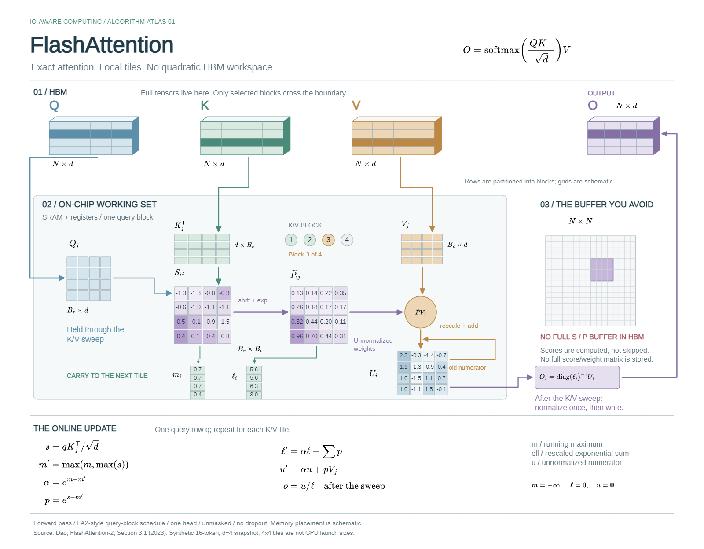

# Obsidian Excalidraw Agent

[English](README.md) · [简体中文](README.zh-CN.md)

**用自然语言描述，得到可继续编辑的图，再查看真实结果。** 本包包含 Agent Skill、原生绘图 MCP／CLI、可选 YAML／JSON 场景 DSL，以及连接 **Obsidian Excalidraw-ymjr** 的 Bridge／Engines。

支持 Claude Code、Codex、OMP 等 Skill／MCP 客户端，也可不经 LLM 直接运行 CLI。**所有执行路径仍需真实的桌面 Obsidian 和修改版插件；不是离线图片生成器。**

[快速开始](#快速开始) · [选择使用方式](#选择使用方式) · [DSL](#用-dsl-维护可重复生成的图) · [完整画廊与源码](docs/gallery.md) · [DSL 详细规范](docs/scene-dsl.md)

## 先看实际效果

下面都是附带源码在真实 Obsidian 中导出的 PNG，不是 UI 效果图。交付物仍是可编辑画布，PNG 用于视觉检查。

### 五级 RISC-V 数据通路


[Python／原生 API 源码](examples/builders/advanced_showcase.py) · [可编辑画布](examples/native/pipeline.excalidraw.md) · [EX 局部大图](docs/images/pipeline-execute.png)。独立部件、命名端口和 68 条声明连接；覆盖 ALU／load／store／BEQ 教学子集，不冒充完整 RV32I 实现或 RTL 仿真。

### FlashAttention · 分块精确注意力



[可编辑画布](examples/native/flashattention.excalidraw.md) · [片上工作集大图](docs/images/flashattention-working-set.png) · [在线 softmax 公式大图](docs/images/flashattention-online-math.png) · [算法原文](https://tridao.me/publications/flash2/flash2.pdf)。图内全部英文，以原生张量投影、局部 score／weight tile 和在线归一化表达机制；共 314 个可编辑元素，其中 23 个公式资源保留源 TeX。前向计算教学示意，数值为合成算例，不作为 GPU 性能测试或芯片平面图。

### 地球科学 · 暖色手绘风景


[源码](examples/builders/diverse_showcase.py) · [可编辑画布](examples/native/water_cycle.excalidraw.md)。原生手绘线、斜线填充、山体和河流，不再是另一张架构卡片图。

### 数学教学 · 深色几何板书


[源码](examples/builders/diverse_showcase.py) · [可编辑画布](examples/native/calculus.excalidraw.md)。函数、切点、斜率和积分结果一致；三条公式真实渲染并保留源 TeX。

### 城市交通 · 导视线路图


[源码](examples/builders/diverse_showcase.py) · [可编辑画布](examples/native/transit.excalidraw.md)。用线路、站点与换乘符号表达拓扑；原创虚构网络，不是导航数据。

### 项目管理 · 原生表格与甘特时间轴


[源码](examples/builders/diverse_showcase.py) · [可编辑画布](examples/native/gantt.excalidraw.md)。直接使用宿主 **light-mint 主题＋grid 模板**，不是逐格模拟样式。

### 生态学 · 论文式原生三线表


[源码](examples/builders/diverse_showcase.py) · [可编辑画布](examples/native/academic.excalidraw.md)。直接使用宿主 **academic 主题＋three-line 模板**；数值全部是演示数据，不作为实验结论。

**这七张 README 展示由 Agent 编写源码、调用原生 API 制作，不是 DSL 输出，也不是整图截图贴进画布。** 两张新版表格图需要**配套原生表格开发版宿主**，安装本包不会自动升级宿主插件。发现 `nativeTable.callable` 后使用 [`drawing_table(create|style)`](skills/obsidian-excalidraw/references/table-native.md)；旧宿主明确报依赖缺失，不模拟新版能力。原有六组 YAML／DSL 及其它示例仍保留在[完整画廊](docs/gallery.md)。

## 选择使用方式

| 你的需求 | 推荐入口 | 谁来组织内容 |
| --- | --- | --- |
| “帮我画这个想法” | 自然语言＋Skill＋MCP | 用户说意图，Agent 选择普通图、DSL 或原生表达并看 PNG |
| 一次性的普通节点关系图 | `drawing_compose(..., inspect=true)` | Agent 提交普通 diagram，执行层合并测量、布局、提交、检查和导出 |
| 可版本管理、重复生成、嵌套区域、表格、多端口 | `drawing_dsl` 或 `launcher.py dsl` | Agent 或人编写精简场景，编译器按稳定身份增量更新 |
| 已有图改字、移动、重连一小部分 | `drawing_read` → `drawing_apply` | 按真实 ID／revision 精确操作，保留无关内容 |
| 原生表格主题与边框模板 | 发现 `nativeTable.callable` 后用 `drawing_table(create|style)` | 由宿主 TableManager 维护语义单元格、主题、边框与排版；需要配套开发版宿主 |
| 素材库、演示框架、交互、导航、动画等 | 原生 MCP＋对应 Skill 参考 | 使用真实宿主能力，不强塞进 DSL 或假装近似实现 |
| 自动化脚本、批量流程 | `launcher.py cli`／`launcher.py dsl` | 不要求 LLM 或 MCP 客户端，但仍要求已连接 GUI 宿主 |
| Agent 在无桌面的开发服务器 | 同一工具经 SSH loopback 隧道调用 | 服务器推理，本地桌面管理 vault、字体、素材与渲染 |
| PNG不符合预期，常规状态／检查无法解释原因 | 可选 `drawing_debug(status|inspect)` | 用户开启只读CDP查看原生状态；微调仍走正常授权API，不用CDP改图 |

**Skill 是工作指导，MCP／CLI 是执行入口，DSL 是可选编译器，Obsidian 原生 API 负责实际构造、保存和渲染。** 只装 Skill 不会自动获得连接；DSL 的 document 也不能当成 drawing_compose 的 diagram。

## 快速开始

### 1. 准备环境

- Obsidian Desktop，目标 vault 已启用 [Excalidraw-ymjr](https://github.com/Bowen-0x00/obsidian-excalidraw-plugin-ymjr)。不能把上游 Excalidraw 当作等价环境。
- [uv](https://docs.astral.sh/uv/getting-started/installation/) 和 Python 3.11+。
- 自然语言路径需要支持 Skill／stdio MCP 的 Agent；要做视觉验收，还需可实际查看图片的模型和客户端。
- [Advanced URI](https://github.com/Vinzent03/obsidian-advanced-uri) 可选，用于自动启动；LaTeX 另需宿主兼容的 Extras MathJax 组件。

### 2. 安装同一个包

**Claude Code／Codex／其他客户端：**

```sh
git clone https://github.com/Bowen-0x00/obsidian-excalidraw-agent-skill.git
```

在仓库目录运行：

```sh
uv sync --frozen
```

复制 `skills/obsidian-excalidraw/` **整个目录**，保留 references 和 prompts：

| 客户端 | 用户级 Skill 目录 |
| --- | --- |
| Claude Code | `~/.claude/skills/obsidian-excalidraw/` |
| Codex | `~/.agents/skills/obsidian-excalidraw/` |

注册同一个 MCP 服务，把绝对路径换成真实安装目录：

```sh
claude mcp add --transport stdio --scope user excalidraw -- uv run --frozen --project "/absolute/path/to/package" python "/absolute/path/to/package/launcher.py" serve
codex mcp add excalidraw -- uv run --frozen --project "/absolute/path/to/package" python "/absolute/path/to/package/launcher.py" serve
```

按客户端选一条，不要两条都运行。Windows 路径可写成 `D:/...`。其他客户端使用相同 stdio 启动命令，详细配置见 [Agent 接入说明](skills/obsidian-excalidraw/references/agent-setup.md)。

**OMP 安装示例：**

```sh
omp plugin marketplace add Bowen-0x00/obsidian-excalidraw-agent-skill
omp plugin install --scope user obsidian-excalidraw-agent-skill@obsidian-excalidraw-agent
```

重启／reload 客户端并检查工具列表。OMP 不是必需依赖，其 `skill://...` 是客户端专有访问方式；其他 Agent 直接读取本地 Skill。

### 3. 连接明确的 vault

保持 Obsidian 打开，让 Agent 用 drawing_setup 连接你选择的 vault；或在包目录运行：

```sh
uv run --frozen python launcher.py connect --vault "/absolute/path/to/vault"
uv run --frozen python launcher.py doctor
```

脚本部署到插件配置的绘图脚本目录下的 `Agent-Drawing/`，不改变插件授信或 autorun 权限。不能自动启动时，先打开一个画布，再在 Obsidian 运行 `Agent-Drawing/mcp/Start-Agent-Drawing`；新命令尚未索引时重载 Obsidian。

已有安装继续使用原私有 state 目录，通过 `EXCALIDRAW_AGENT_STATE_DIR` 指定，避免意外配置第二条连接。`launcher.py status` 会说明当前目录和目标，不输出 bearer token。

在另一个vault目录启动Agent，**不会自动切换用户级Bridge连接**；先核对`vault_path`。`configured:true`不证明服务已连接；缺Advanced URI时按提示手动运行启动命令。脚本覆盖保护不可通过重写安装所有权或搜历史token绕过。长驻客户端现会在下一次请求前读取最新私有连接配置；旧MCP进程需reload一次加载此修复。[连接排错](skills/obsidian-excalidraw/references/agent-setup.md)。

## 自然语言绘图

普通用户不需要懂 DSL：

> 画变更上线流程：提交申请，检查评审、测试与回滚方案；通过后灰度发布，未通过则修订再提交。保留全文，检查 PNG。

> 画异步任务平台，分接入、执行、持久化三个区域。更新状态与查询进度的走线要容易区分。

> 画 Tomasulo 教学结构，要有独立指令队列、Qi 寄存器表、保留站字段、执行器和 CDB 命名端口，不要做成阶段说明卡片。

> 修改我指定的已有画布中的一个节点标签，其他内容和样式不变。

新图先真实询问未定的 **style 和 review 等级**，与色板、背景、字体意图合并一轮；推荐值不是用户回答，“重试／继续／帮我画”不是免问。明确指定、原图／同套图继承、用户明确授权默认值逐项记录到必需的`brief`；用户需求逐项验收。见[偏好与任务单格式](skills/obsidian-excalidraw/references/diagram-recipes.md)和[验收证据](skills/obsidian-excalidraw/references/acceptance.md)。硬件仍按部件／端口／信号组织；kind或泳道都不是硬件自动布局器。

先用 **`drawing_begin(request,action:"prepare")`**：工具实际返回本包Skill、任务专用参考、原生操作示例与当前宿主证据，不依赖客户端自动激活Skill。任务单齐全后drawing_begin(create|bind)。drawing_apply现为op判别式schema，在任何HTTP写入前拒绝错名和错层字段。硬件brief声明部件/端口/信号契约，drawing_contract映射真实body/wire IDs，check/review/deliver按保存几何重算；文字报告不能冒充器件。

看过当前PNG并取得completed评审后调用 **`drawing_deliver(context_token,revision,preview_id)`**；只有deliverable回执才确认同一owned file、当前revision、完整全图PNG/hash、完成评审及当前需求/表达检查。写入成功、check pass和PNG已生成都不等于完成。[执行格式、CLI入口及几何/信任边界](skills/obsidian-excalidraw/references/workflow-details.md#启动表达与交付的执行契约)。回执不冒充科学/电气验证，也不能控制模型任意聊天中的虚假断言。

**0.10.4 教学图法关口：**先问“该用什么可视结构解释学习目标”，提出2–3个候选、取舍与推荐，用真实选择UI确认；用户明确授权／已有方案继承才跳过。drawing_begin(prepare,design)返回可交给ask的选项，创建前brief.teaching_plan必须记录确认。配色／手绘选项不等于表达方案。[执行契约与组件](skills/obsidian-excalidraw/references/teaching-design.md)。

新增序列窗口／掩码、矩阵行列分组、位宽格、逻辑物理块映射、时间步状态，仍用原生图元和已有增量协调器。check/review/deliver核对实际编码，不接受段落里提到术语。教学评审增加逐goal的expression_checks，描述看到了什么几何，以及“不读长段正文能看懂什么”；观察仍为Agent自述，不冒充通用独立语义裁判。不自动改写remote已有交付图。


技术插图继续共用当前执行Skill，新增[视觉设计层](skills/obsidian-excalidraw/references/visual-design.md)，不按每个题材复制完整工作流。物理剖面／封装／爆炸走`physical_structure`＋`brief.visual_plan`；页面讲解走`explanatory_page`。逻辑数据通路仍须端口／信号契约，引出线不当电气线。[投影／层叠／阵列／标注及同ID增量规范](skills/obsidian-excalidraw/references/technical-illustration.md)通过drawing_primitives执行；需要 **0.10.3 或更新运行包**，请同时更新运行包和Skill。

[封装原生案例](examples/native/package-illustration.excalidraw.md)由真实shape／polygon／text重绘，不是整图截图。[构建器](examples/builders/package_illustration.py)可修改HBM层数、Logic位置和Interposer厚度，同state更新保留已有层／部件ID。[实际PNG](docs/images/package-illustration.png)。尺寸、材料和重复数量为示意，不作CAD、制造或热／电性能结论。


数学内容按**语义而非美元符号**分流：矩阵、数学向量／转置、分式、求和与结构化上下标走已有保留源TeX的LaTeX入口，不用空格／Unicode或偏移小字模拟。RTL标识／总线切片、位串、引脚和波形仍保留原生文字／图元。[数学分流与混排验收](skills/obsidian-excalidraw/references/visual-content.md#数学内容分流-先认语义再选元素)分别核对源TeX、真实公式资源与PNG，不把数值正确当排版通过；这是Skill工作流，不冒充自动数学语义校验器。


## 用 DSL 维护可重复生成的图

编译器随包提供，不另建安装，也不需要 `--backend` 指向另一份 runtime：

```sh
uv run --frozen python launcher.py dsl -- fonts
uv run --frozen python launcher.py dsl -- render examples/dsl/release-flow.yaml --font "EXACT_HOST_FAMILY" --brief-file ./drawing-brief.json --state-id release-demo --filename "Release-Demo-Unique" --output ./output/release.json
```

`EXACT_HOST_FAMILY` 必须替换为当前发现的精确字体名。命令生成原生元素，以及客户端上的 `release.json`／`release.png`。修改 YAML 后复用**同一个 state-id**再次 render，更新原 ID，不追加第二张图；以后可省略 filename。相同源是零绘图操作。不能删 state 或改用 compose 整图重放绕过冲突。

首绘前按上述格式，将真实选择来源与需求保存为`drawing-brief.json`，不能复制示例伪称用户已同意。CLI与MCP执行相同门禁。旧画布首次写入先bind并补齐brief；只读发现／读取／测量不要求任务单。重绑继承同任务／文件的验收历史。Bridge 0.13.7在提交任何批量元素前拒绝错位／未知字段；原生文字的字体、字号、行高测量复用创建路径。


MCP Agent 使用新增的 **`drawing_dsl(action, document, font_family, state_id, ...)`**，document 是同一场景的已解析 JSON 对象。首次 render 需要唯一 filename 或明确现有 file_path；只读 plan 需要已有 state／file_path 来真实测量文字。返回实际检查后的 PNG ImageContent，不会自动宣布视觉通过。CLI 与 MCP 共用一个编译执行实现。

[DSL 详细规范](docs/scene-dsl.md) 包含语法、JSON／MCP 示例、只读规划、资源、增量限制、私有状态和实际 review 命令。DSL 负责测量后的空间场景；素材库、交互、动画、任意扩展、非受管图的精确修改仍走原生路径。GUI 修改受管内容会触发冲突，不自动反向合并回 YAML。

## 原生精确编辑与自动化

原有工具全部保留：context/read/measure/plan/apply/check/preview/review/revert，以及 compose、templates、primitives、library、present。本包 CLI 使用相同绘图客户端：

```sh
uv run --frozen python launcher.py cli -- context --action bind --file-path "Agent-Diagrams/existing.excalidraw.md"
uv run --frozen python launcher.py cli -- read --context-token "RETURNED_CONTEXT_TOKEN" --detail full
uv run --frozen python launcher.py cli -- --help
```

用实际返回的 ID／revision 提交 apply，再 check／preview／看图／review。插件自身的 `obsidian ...:...` 原生 CLI 是**另一套接口**，先读其当前 help／schema 和 [原生 CLI 参考](skills/obsidian-excalidraw/references/native-cli.md)；远端不能假设有宿主可执行文件或直接访问宿主路径。

## 可编辑性与验收边界

- 输出保留原生形状、文字、箭头、绑定，以及实际使用的组／frame、SVG-path carrier、源资源，不是一张扁平化整图。
- DSL 表格是直角 cell＋绑定文字＋分层表头，不宣称新增 Table Engine 交互；DSL groups 是可见布局区域，不等于自动原生 group／frame。
- ECharts 1.3.0 覆盖多系列、堆叠、双轴、数值 XY 等；16 个示例是 12 种基础图型＋custom／变体。高级 DSL／MCP 图用 custom 保留完整 options，JSON 往返与可视表单数据模型往返不是同一承诺。
- 检查覆盖结构、显式语义断言、几何和文字可读风险；真实 PNG 仍需判断内容、遮挡、走线与层级。check=pass 不是专业质量的自动证明。
- 验收 **low／medium（默认）／high** 与模型 effort 无关。medium 记录实际内容／可读／遮挡观察；high 再核对连接与层级风格，不强制所有合法独立箭头绑定。
- 字体被发现不等于每字无 fallback；资源完整不等于交互通过。hover、折叠、导航、dataZoom 和动画需要在真实界面触发观察。

图片、公式、扩展效果和交互取决于宿主资源。缺能力或几何 unknown 会明确报告，不用假图片或删除内容掩盖。

## 服务器开发，本地渲染


服务器不需要 GUI／X11；本地桌面负责字体、素材和渲染。宿主 vault 路径、客户端输出路径、私有 state 分开理解。remote-deploy 是面向 OMP 的便捷注册；其他客户端可启动同一远端 stdio runtime。完整步骤见 [接入说明](skills/obsidian-excalidraw/references/agent-setup.md)。

## 可选 CDP 只读排错

**默认关闭，由用户选择。** 绘制效果异常、常规 Bridge 状态／PNG 无法解释原因时，Agent 会提示是否开启详细诊断：图层顺序、显示／源文字、绑定、原生表格、图片引用、Canvas／视口与 renderer 异常计数。

针对已经运行、用户明确选择的 Obsidian 调试实例：

```sh
uv run --frozen python launcher.py cdp -- status
uv run --frozen python launcher.py cdp -- enable --endpoint http://127.0.0.1:19223 --vault-path "D:/Lab/MyVault"
uv run --frozen python launcher.py cdp -- inspect --file "Drawings/Example.excalidraw.md"
uv run --frozen python launcher.py cdp -- disable
```

端口与路径替换为实际宿主值。Obsidian 需要由用户明确以 `--remote-debugging-port=PORT` 启动；诊断工具不启动／重启程序。开发验收优先独立 profile **加独立 vault**；远端另行明确配置 CDP SSH 隧道，普通 Bridge 隧道不等于 CDP 隧道。

MCP 只提供 **`drawing_debug(status|inspect)`**，没有开启权限或任意 JS 参数。目标必须已打开；不会打开文件、换焦点、点击、拖拽、暂停、保存、导出、重载插件或修改画布。固定查询使用 V8 副作用保护，无法确认安全就拒绝，禁止取消保护重试。开关保存在本客户端私有 state 中，不随远端安装自动开启。

**微调仍走用户已授权的正常 Bridge／API 或 DSL 修改**，取得最新 revision，最终看 PNG／review；只允许诊断不等于允许修图。CDP 本身不是只读或沙箱，此限制适用于本包受保护诊断器，不约束其它调试客户端。不要公开调试端口，也不要用 browser／raw evaluate 绕过只读边界。[完整开关与排错流程](skills/obsidian-excalidraw/references/cdp-readonly.md)。

## 只读与你相关的文档

| 主题 | 入口 |
| --- | --- |
| 实际图片、源码、规模与限制 | [示例画廊](docs/gallery.md) |
| YAML／JSON、MCP／CLI、增量与 review | [Scene DSL 规范](docs/scene-dsl.md) |
| 图片、公式、扩展、表格与特殊图 | [能力地图](skills/obsidian-excalidraw/references/capability-map.md) |
| 查询用户素材库、只修改描述 | [素材库](skills/obsidian-excalidraw/references/library-catalog.md) · [维护 prompt](skills/obsidian-excalidraw/prompts/maintain-libraries.zh-CN.md) |
| 硬件部件／端口／信号与保存后路由审计 | [微架构](skills/obsidian-excalidraw/references/microarchitecture.md) |
| 风格、真实字体和视觉验收 | [风格](skills/obsidian-excalidraw/references/diagram-recipes.md) · [排版](skills/obsidian-excalidraw/references/typography.md) · [验收](skills/obsidian-excalidraw/references/acceptance.md) |
| 可信脚本、插件原生 CLI、交互 | [脚本](skills/obsidian-excalidraw/references/script-execution.md) · [原生 CLI](skills/obsidian-excalidraw/references/native-cli.md) |
| CDP只读开关、详细debug与安全微调 | [只读CDP排错](skills/obsidian-excalidraw/references/cdp-readonly.md) |
| 共享 Engine 来源、同步与发布检查 | [维护说明](docs/maintenance.md) |
| 与其他绘图工具的设计比较 | [next-ai-draw-io](skills/obsidian-excalidraw/references/next-ai-draw-io.md) |

用户 `.excalidrawlib` 不随包分发；使用时查询当前真实 item／预览，修改库本身不需要升级 Skill。原生 professional／visio／handdrawn／blueprint／presentation 是属性风格，不代表生成 `.vsdx`／`.pptx` 或应用图片滤镜；自由笔画与 Rough.js 风格也不同。

## 更新与安全

克隆安装：停止本包 MCP，pull、`uv sync --frozen`、同步已复制 Skill，再重启 MCP。OMP 按接入说明执行 marketplace update／plugin upgrade；Windows 先断开旧 MCP，避免缓存被锁。重新连接**同一 vault**更新受管脚本，自定义文件仍受冲突保护；必要时重载 Engine／Obsidian。保留私有连接配置、DSL 身份状态和评审产物。

**0.10.3 升级：**同时更新运行包和已复制规范，再重载MCP／Skill。drawing_primitives新增物理组件和带state_id／base_revision的托管render；物理视图用visual_plan，不虚构电气信号。保留已有场景身份与评审状态。Start／Bridge仍为 **0.13.7**，已匹配宿主不需重启。


**0.10.2 升级：**同时更新运行包与已复制Skill，再重载MCP／Skill。工具列表应有drawing_begin、drawing_contract、drawing_deliver；只复制Skill不会增加API。新硬件任务在创建前声明representation，评审前映射保存的body/wire IDs。Start／Bridge仍为 **0.13.7**，已运行匹配宿主不需重启或重新连接。保留私有连接、task／DSL状态及历史版本缓存。


**0.10.0 升级：**逐个更新／连接已配置 vault 的受管 bundle，再运行各库的 `Agent-Drawing/mcp/Start-Agent-Drawing`，并重载 MCP。bootstrap 与 Bridge 都应为 **0.13.7**；仅更新 Skill 不会替换运行中的宿主。新图先询问未定 style／review，并提交已回答的 `brief`；评审增加逐项用户需求覆盖。固定安装诊断命令为 `launcher.py smoke --font "当前发现的精确字体" --filename 唯一测试名`。保留私有状态，不重写备份或旧版本快照。


Bridge 是有 vault 读写权限的可信本地代码，**不是沙箱**；监听 loopback 并鉴权。凭据不进入 prompt、场景、公开报告或 Git。包含代码的 customData／素材脚本、外部应用写入和附加 Engine，不因用户要求画图就自动授信。模型提供方会接收其处理的 prompt／图片。

原创包代码和自制示例采用 [MIT](LICENSE)；内嵌库保留[第三方许可证](THIRD_PARTY_NOTICES.md)。与 Obsidian／上游 Excalidraw 无官方关联。[变更记录](CHANGELOG.md)。
