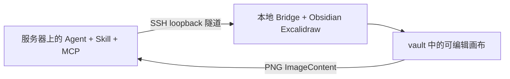

# Obsidian Excalidraw Agent

[English](README.md) · [简体中文](README.zh-CN.md)

让 Agent 根据自然语言，在 **Obsidian Excalidraw-ymjr** 中创建、修改可编辑的图，并通过真实 PNG 检查结果。

**适用于 Claude Code、Codex、OMP，以及能加载 Skill 和调用 MCP 的其他 Agent。OMP 只是本文的一种安装示例，不是必需依赖。**

## 能做什么

- 绘制流程图、架构图、UML、泳道、脑图、数字电路、波形和演示页面。
- 插入网上获取的图片、公式和用户素材；用 SVG path 制作可复用组件。
- 使用修改版提供的视觉效果、交互和导航功能。具体支持取决于宿主插件与已启用的脚本。
- 测量文字、规划布局、检查关系与几何约束，查看 PNG 后局部修正，保留其他内容。

## 可编辑、多风格与服务器绘图

### 可编辑不是导出图片

Agent 生成的是 Obsidian Excalidraw 原生元素：shape、text、arrow、frame、group、绑定关系、图片资源和可修改的 SVG path carrier。PNG 只用于视觉检查，不替代画布。用户可以在 Obsidian 中继续拖动、改字、重连和调整样式。

### 风格是布局/属性 profile，不是图片滤镜

| 风格 | 规则 |
| --- | --- |
| `professional` | 平整、克制、适合文档 |
| `visio` | 低粗糙度、锐利边、规整分区和工程连接 |
| `handdrawn` / `roughjs` | Rough.js roughness/hachure 手绘渲染，仍保留原生元素 |
| `blueprint` | 白底蓝线，适合电路和微架构 |
| `presentation` | 更大字号和更强标题层级 |
| 原生自由笔画 `draw/freedraw` | 手画/handdraw白板笔迹，保留点列与压力；不是另一个Rough.js profile |

“手绘风格”不等于自由笔画；用户说 handdraw/手画笔迹时使用原生freedraw。`visio`不代表生成`.vsdx`，`roughjs`也不代表生成不可编辑图片。真实演示及可复制的录制prompt见[演示与GIF指南](skills/obsidian-excalidraw/references/showcase.md)。

### 服务器调用本地绘图



服务器负责理解需求、调用 Skill/MCP、读回摘要、接收 PNG 和决定迭代；本地桌面负责真实插件、vault、字体、图片资源和渲染。已有SSH连接的开发服务器无需GUI或X11。当前remote-deploy便捷注册面向OMP，其他Agent注册同一远端运行时，见[Agent接入说明](skills/obsidian-excalidraw/references/agent-setup.md)。服务器路径不能直接当宿主vault路径。

next-ai-draw-io的 canvas-first、内容级编辑门、版本/缩略图和截图验证值得借鉴；具体比较见 [next-ai-draw-io参考](skills/obsidian-excalidraw/references/next-ai-draw-io.md)。

仓库包含三部分：**Skill** 告诉 Agent 怎样工作；**MCP 服务**提供操作工具；**Obsidian 绘图脚本**在应用里构造元素、管理扩展并渲染。只安装 Skill 不会自动获得执行能力。

## 开始前

准备好：

1. Obsidian Desktop，以及目标 vault 中已安装并启用的 [Excalidraw-ymjr](https://github.com/Bowen-0x00/obsidian-excalidraw-plugin-ymjr)。本方案依赖修改版，不能直接当作上游插件通用方案。
2. 支持 Skill 和本地 stdio MCP 的 Agent；若要完成视觉检查，还需能查看图片的模型和客户端。
3. [uv](https://docs.astral.sh/uv/getting-started/installation/) 和 Python 3.11+，用于运行本包 MCP。

[Advanced URI](https://github.com/Vinzent03/obsidian-advanced-uri) 可选：有它可自动启动绘图服务，没有它就在 Obsidian 中手动运行启动脚本。LaTeX 另需兼容的 Excalidraw Extras MathJax 组件。

## 1. 安装 Skill 和 MCP

只选择与你的 Agent 对应的一种方式。

### Claude Code / Codex

克隆仓库，并在仓库目录安装依赖：

```sh
git clone https://github.com/Bowen-0x00/obsidian-excalidraw-agent-skill.git
```

```sh
uv sync --frozen
```

把 `skills/obsidian-excalidraw/` **整个目录**复制到对应位置，保留其中的 references 和 prompts：

| Agent | 用户级 Skill 目录 | 调用示例 |
| --- | --- | --- |
| Claude Code | `~/.claude/skills/obsidian-excalidraw/` | `/obsidian-excalidraw` |
| Codex | `~/.agents/skills/obsidian-excalidraw/` | `$obsidian-excalidraw` |

再注册同一个 MCP 服务。把命令中的 `/absolute/path/to/package` 换成仓库的实际绝对路径；Windows 可用 `D:/...`。

**Claude Code：**

```sh
claude mcp add --transport stdio --scope user excalidraw -- uv run --frozen --project "/absolute/path/to/package" python "/absolute/path/to/package/launcher.py" serve
```

**Codex：**

```sh
codex mcp add excalidraw -- uv run --frozen --project "/absolute/path/to/package" python "/absolute/path/to/package/launcher.py" serve
```

重启 Agent，在其 MCP 面板确认服务可用。这里使用通用 Skill 文件和标准 MCP；其他客户端配置同样的启动命令即可。详细配置和官方文档链接见 [Agent 接入说明](skills/obsidian-excalidraw/references/agent-setup.md)。

### OMP 示例

```sh
omp plugin marketplace add Bowen-0x00/obsidian-excalidraw-agent-skill
omp plugin install --scope user obsidian-excalidraw-agent-skill@obsidian-excalidraw-agent
```

此方式同时安装 Skill 和注册包内 MCP。重启 OMP，或执行 `/reload-plugins`；用 `/mcp list` 查看服务。OMP 的 `skill://obsidian-excalidraw` 是该客户端的访问方式，其他 Agent 直接读取 Skill 文件和相对参考文件。

## 2. 连接 Obsidian

保持 Obsidian 打开，告诉 Agent：

> 使用 obsidian-excalidraw Skill，连接我选择的 Obsidian vault，并检查绘图服务。

Agent 通过 `drawing_setup` 发现 vault、部署所需脚本并连接。脚本安装在插件配置的**绘图脚本目录**下的 `Agent-Drawing/` 子目录；不要求目录叫某个固定名字，也不修改用户的插件启用权限。

自动启动失败时，打开一个画布，在 Obsidian 命令面板运行：

```text
Agent-Drawing/mcp/Start-Agent-Drawing
```

新脚本尚未被索引时，重载 Obsidian。也可以在仓库目录使用 `uv run --frozen python launcher.py status` 查看状态，使用 `launcher.py connect --vault "实际vault路径"` 连接；完整命令见接入说明。

## 3. 描述需求，查看结果

例如：

> 画申请审批流程：提交申请→审核；通过则发放凭据，未通过则说明拒绝原因，两路到结束。保留完整中文，检查 PNG。

> 从我的数字电路素材库中选择 MUX、ALU 和 Register File，画一张数据通路图。保留原符号和可编辑连接。

> 修改指定画布中的一个节点标签，其他内容和样式不变。

原图保存在已连接的 vault；PNG 和评审记录保存在 MCP 的数据目录。Agent 会读取画布、检查约束、查看新 PNG，再修复具体问题。默认最多五轮，达标即停止；缺资源、无法查看图片或仍有问题时明确报告。

**PNG 外观正确不等于交互已验证。** Hover、折叠、缩放导航和动画还要在真实画布中触发与观察。

## 使用与更新自己的素材库

`.excalidrawlib` 是用户资源，**不复制进 Skill，也不随本包分发**。Agent 每次使用时查询当前库，核对 item ID、内容和预览，再原生导入。

- 只增删或修改 item：无需升级 Skill，重新查询库即可。
- 维护了 item `description` 或 `library-index.md`：库变化后更新这些用户描述/摘要，避免过时；不能仅凭旧摘要选素材。
- 渲染机制、资源格式或调用接口改变：才需要修改 Skill 或执行适配器。

需要 Agent 帮你整理描述和摘要时，复制 [素材库维护 prompt](skills/obsidian-excalidraw/prompts/maintain-libraries.zh-CN.md)，追加库路径和补充说明。它只按授权维护描述，保留图元、资源、ID 和人工意见。详见 [素材库参考](skills/obsidian-excalidraw/references/library-catalog.md)。

## 按需阅读

| 需要了解 | 入口 |
| --- | --- |
| 图片、SVG 组件、脑图、波形、交互、动画等能力与限制 | [能力地图](skills/obsidian-excalidraw/references/capability-map.md) |
| Claude Code / Codex / OMP 配置、远端绘图、状态目录与更新 | [Agent 接入说明](skills/obsidian-excalidraw/references/agent-setup.md) |
| 开发绘图脚本，通过 URI 运行并检查 PNG | [脚本执行参考](skills/obsidian-excalidraw/references/script-execution.md) |
| 使用插件自带的 CLI，而非本包 MCP | [原生 CLI 参考](skills/obsidian-excalidraw/references/native-cli.md) |
| next-ai-draw-io 对本项目的借鉴 | [比较参考](skills/obsidian-excalidraw/references/next-ai-draw-io.md) |
| 版本变化 | [CHANGELOG](CHANGELOG.md) |

## 更新与安全边界

克隆安装用 `git pull`、`uv sync --frozen`，同步已复制的 Skill 并重启 MCP。OMP 安装用 marketplace update / plugin upgrade，具体命令见接入说明。包更新后，重新连接**同一 vault**更新受管脚本；用户修改过的文件不会静默覆盖。

Bridge 是有 vault 读写权限的可信本地代码，仅监听 loopback 并鉴权，不是沙箱。不要公开私有连接文件；外部素材中的可执行代码需明确授权。Anki/Eagle 写入、额外 Engine 挂载和动画播放不是普通 PNG 导出的默认副作用。模型服务会接收它处理的提示与图片。

原创包代码采用 [MIT](LICENSE)，内嵌库保留 [第三方许可证](THIRD_PARTY_NOTICES.md)。本项目与 Obsidian、上游 Excalidraw 无官方关联。
