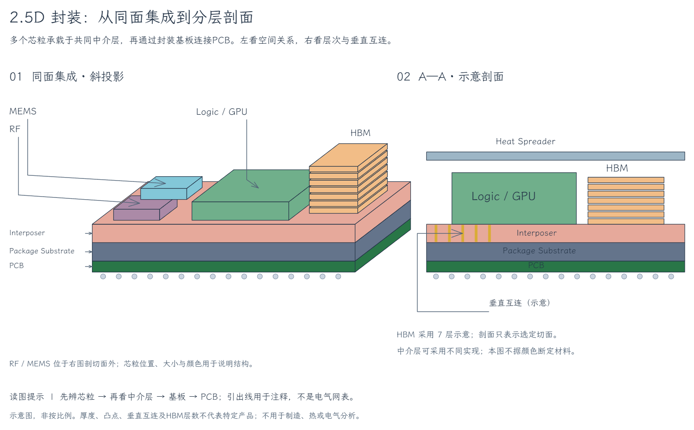
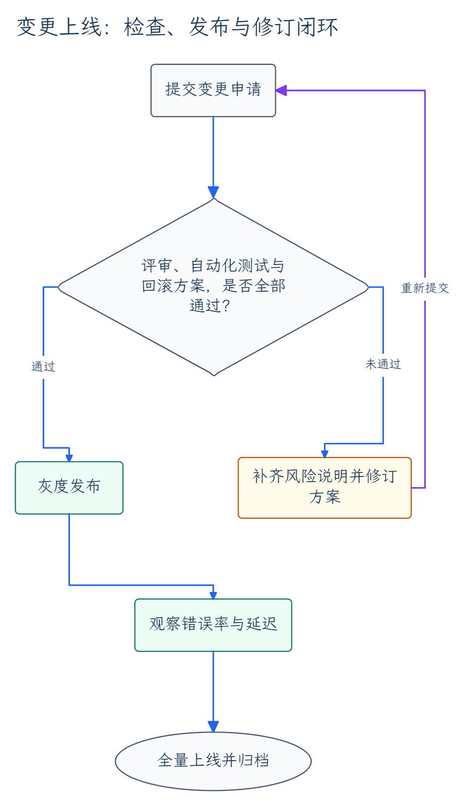
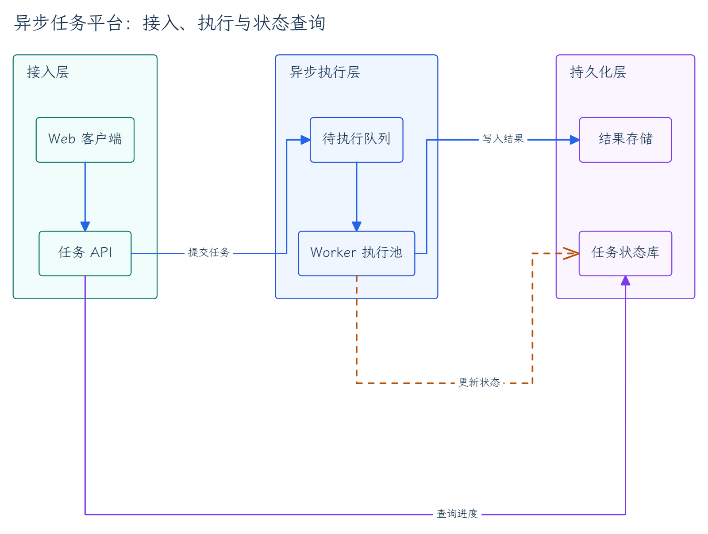
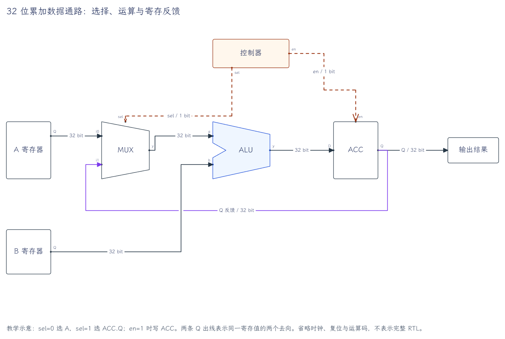
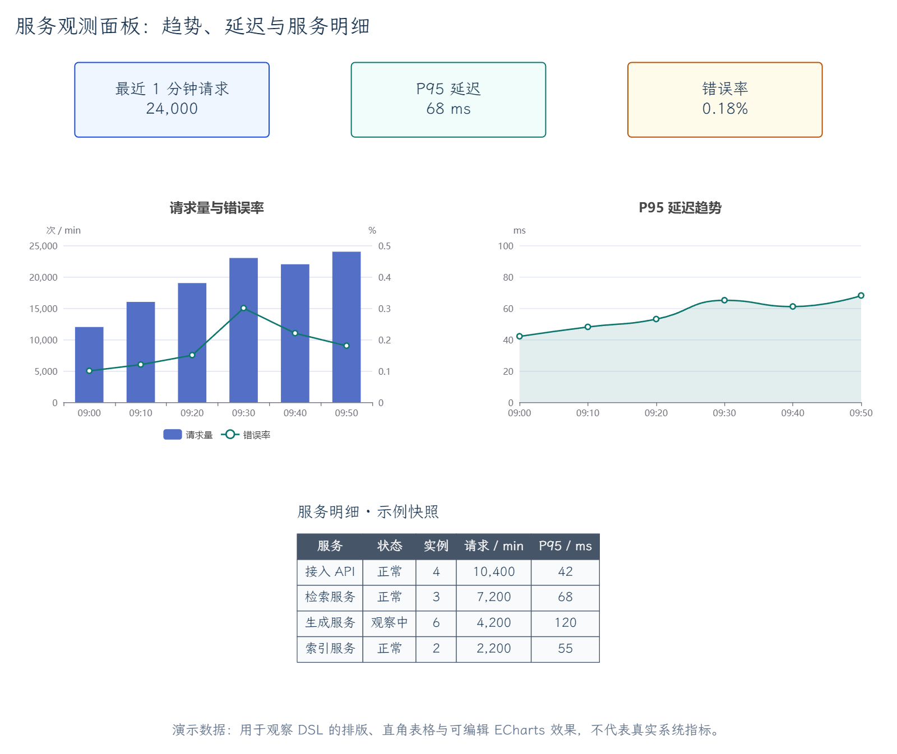
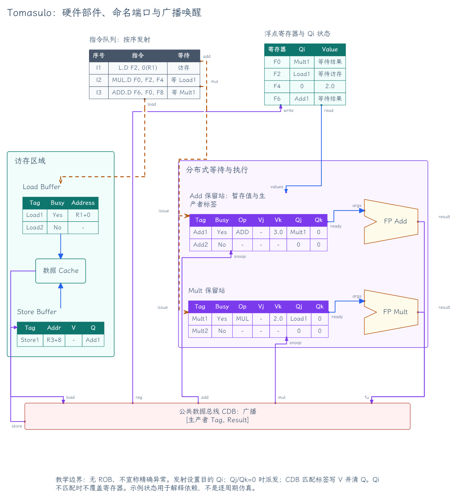
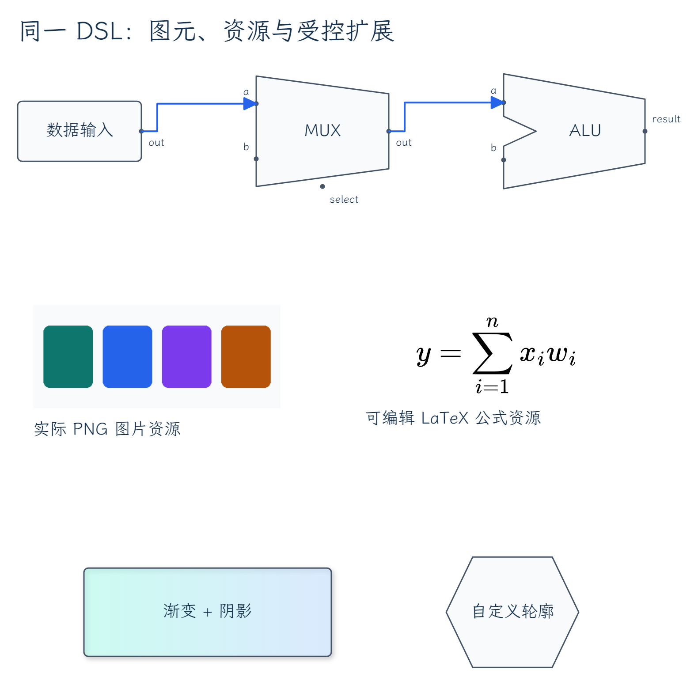
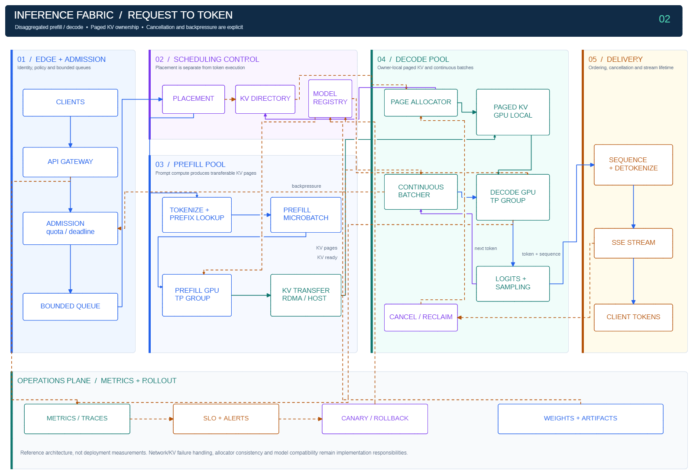
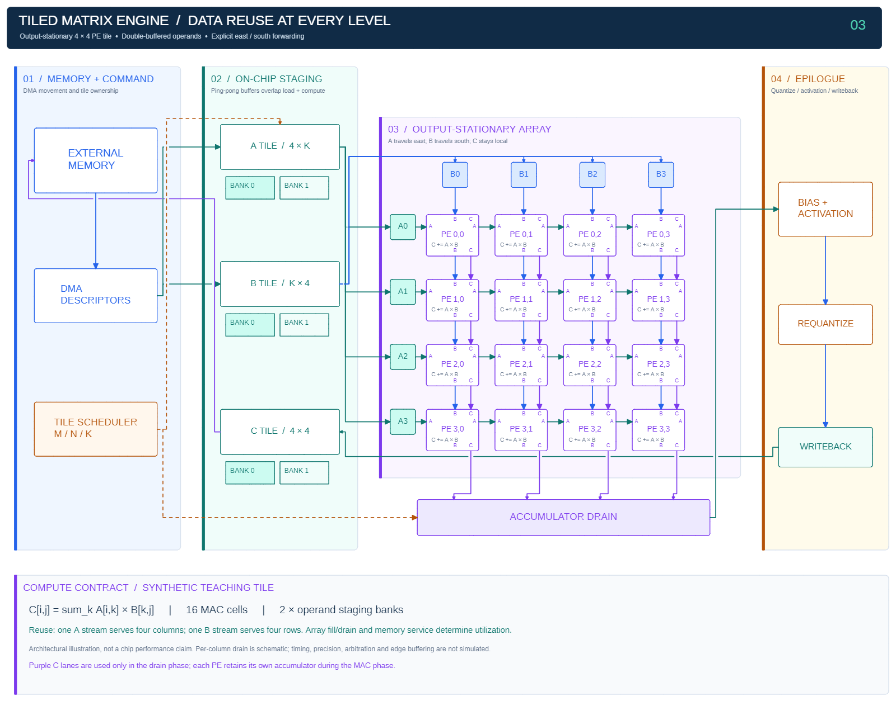

# Real drawing gallery / 真实绘图画廊

These previews are **actual Obsidian Excalidraw-ymjr exports**: six YAML/DSL examples, three retained systems/hardware examples and five new cross-domain native drawings. Sources, native canvases and real PNGs are included. The README selects RISC-V plus the five varied examples below; inference and matrix-engine diagrams remain archived here.

以下展示均由真实宿主渲染。README 保留五级 RISC-V，并新增地球科学、数学、城市交通、项目计划、生态学五个不同领域／表现形式；原图保留在本画廊，不因更换展示删掉已有能力。

## Reference-driven physical illustration / 参考图驱动的物理示意

[Native canvas](../examples/native/package-illustration.excalidraw.md) · [Builder](../examples/builders/package_illustration.py)



Actual host export: oblique heterogeneous chiplets plus a section showing Logic/GPU, HBM, Interposer, Package Substrate, PCB and heat spreader. The final scene has 118 native text/rectangle/ellipse/line/arrow elements and no raster image. RF/MEMS are explicitly outside the section. Reference colors encode roles, not verified material properties.

Real same-file updates changed HBM 5→7 layers in both views, shifted Logic by 25 scene units and thickened the Interposer from 28→40 schematic units. Existing body/layer IDs survived; base/PCB geometry stayed fixed while upper structures and labels followed. A newly added top face initially hid an old HBM arrowhead; actual PNG review caught it and the label was placed outside the growing stack rather than claiming check pass proved visibility. Final high PNG review and delivery passed. Thickness/counts are illustrative, not a manufactured package or physical simulation.


## Coverage and complexity / 范围与复杂度

| Example / 示例 | Method / 制作方式 | Native elements / 原生元素 | Declared connections / 连接 | What it demonstrates / 表达能力 |
| --- | --- | ---: | ---: | --- |
| Release flow / 变更上线 | Scene DSL | 22 | 6 | Long Chinese decision, branch labels and resubmission loop |
| Task architecture / 异步任务架构 | Scene DSL | 29 | 6 | Three measured regions, state update and external query tracks |
| Feedback datapath / 寄存反馈 | Scene DSL | 62 | 8 | MUX/ALU polygons, named ports, data/control/feedback separation |
| Observability panel / 观测面板 | Scene DSL | 62 | 0 | Native sharp-cell table, KPI blocks and two ECharts carriers |
| Tomasulo | Scene DSL | 259 | 15 | Dense native tables, independent units/ports, CDB-related connections |
| Resources / 资源与效果 | Scene DSL | 36 | 2 | PNG asset, source-preserving LaTeX, gradient/shadow and editable polygons |
| Five-stage datapath / 五级数据通路 | Python + native API | 234 | 68 | 21 components, pipeline boundaries, forwarding, interlock and branch flush |
| Inference fabric / 分布式推理 | Python + native API | 113 | 32 | 24 modules, separate prefill/decode, KV ownership, delivery and operations |
| Matrix engine / 矩阵加速器 | Python + native API | 285 | 66 | 34 components including 16 MAC cells, two-bank staging and drain-only C lanes |
| Water cycle / 手绘水循环 | Python + native API | 56 | — | Landscape, hand lettering, hachure, layered geography and physical-process arrows |
| Calculus / 深色微积分 | Python + native API | 55 | — | True tangent, upper rectangles, integrated area and three rendered TeX equations |
| Transit / 城市交通 | Python + native API | 57 | — | Three schematic services, twenty stations and two shared interchanges |
| Project Gantt / 项目计划 | Python + native TableManager | 61 | — | Mint semantic table, measured unequal columns and aligned seven-week timeline |
| Ecology / 学术三线表 | Python + native TableManager | 56 | — | Native academic border template, editable botanical symbols and mass-ratio equation |

Counts include active native labels, binding anchors and port markers; they are not logical-node counts or a performance benchmark. Dashboard zero connections is intentional. Example metrics and hardware states are synthetic teaching material.

## 1. Release flow / 变更上线

[Source YAML](../examples/dsl/release-flow.yaml) · [Native canvas](../examples/native/release-flow.excalidraw.md)



Full Chinese content is retained and wrapped using the actual host font. Approved/rejected paths and the resubmission loop remain independent native arrows with bindings. This is an ordinary flow example, not a complete release-management policy.

## 2. Fixed-region architecture / 分组架构

[Source YAML](../examples/dsl/task-architecture.yaml) · [Native canvas](../examples/native/task-architecture.excalidraw.md)



Regions come from explicit row/column composition. Progress and query paths have declared waypoints/label positions after real PNG feedback; automatic routing is not presented as a perfect first-pass result. DSL regions are visible layout regions, not native group/frame semantics.

## 3. Feedback datapath / 硬件反馈数据通路

[Source YAML](../examples/dsl/feedback-datapath.yaml) · [Native canvas](../examples/native/feedback-datapath.excalidraw.md)



The MUX and ALU are editable native polygons with anchors and labels; registers, result and controller are separate objects. Source and picture explicitly omit clock/reset/opcode. Two Q destinations are a schematic representation, not a certified electrical netlist. Route labels were repaired without deleting required relations or rebuilding the canvas; saved endpoints may have subpixel native rounding.

## 4. Table and ECharts / 表格与图表

[Source YAML](../examples/dsl/observability-panel.yaml) · [Native canvas](../examples/native/observability-panel.excalidraw.md)



The table is native sharp-corner cells plus bound text, with measured unequal columns and a contrasting header. ECharts retains complete JSON options in native rectangle carriers; the whole scene is not rasterized. The PNG verifies the static plots/axes/legend, not live hover/dataZoom or a visual-form editing roundtrip. All displayed service metrics are demonstration data.

## 5. Dense teaching diagram / 密集教学结构

[Source YAML](../examples/dsl/tomasulo.yaml) · [Native canvas](../examples/native/tomasulo.excalidraw.md)



Reservation-station Tag/Busy/Op/Vj/Vk/Qj/Qk fields, Qi register state and queue/buffer entries remain individual editable cells and text. FP units use polygon silhouettes and named ports. The figure declares its teaching boundary: no ROB/precise-exception implementation and no cycle-by-cycle simulation proof. Overview/detail readability and declared bindings were inspected, not inferred from element count alone.

## 6. Source-backed resources / 资源与效果

[Source YAML](../examples/dsl/resources.yaml) · [Original PNG asset](../examples/dsl/assets/sample.png) · [Native canvas](../examples/native/resources.excalidraw.md)



The formula is rendered by the actual host MathJax path with TeX retained, not literal source text. The image is an original generated PNG asset, and gradient/shadow use the host's controlled adapters. These examples do not redistribute a user's `.excalidrawlib` or assume every host has identical fonts/resources.

## 7. Five-stage datapath / 五级 RISC-V 数据通路

> 画五级 RISC-V 数据通路：部件级展示寄存器堆、立即数生成、独立旁路 MUX、ALU、分支比较、存储器和流水寄存器；把 load-use 停顿、分支 flush 和写回反馈画清楚。

[Authored Python: `pipeline`](../examples/builders/advanced_showcase.py) · [Native canvas](../examples/native/pipeline.excalidraw.md)


This is an authored **ALU/load/store/BEQ teaching subset**, not a complete RV32I implementation. Four narrow pipeline registers, native MUX/ALU polygons, separate RF addresses/data, 00/01/10 forwarding choices and distinct control D/Q terminals are editable objects. EX/MEM forwarding is an ALU result, not a pending load value; load-use holds PC/IF-ID and bubbles ID/EX. EX-taken branches redirect PC and flush IF/ID plus ID/EX.

The overview locates the networks; its small port text is not advertised as presentation-sized. Read the actual selection previews: [fetch](images/pipeline-fetch.png), [decode](images/pipeline-decode.png), [execute](images/pipeline-execute.png), [memory/writeback](images/pipeline-memory.png), [interlock/forwarding](images/pipeline-controls.png). Selection exports omit outside elements and cross-region wires; they are not lossless rectangular crops. Use the full canvas for end-to-end paths.

No JAL/CSR/traps/MUL-DIV, complete control truth table, clock/reset wiring or RTL timing proof is claimed. The source declares these omissions; native binding checks do not certify an electrical netlist.

## 8. Distributed inference / 分布式推理全景

> 画解耦 Prefill／Decode 的推理系统：从鉴权准入、队列与调度到 KV 页传输、连续批处理、采样和 SSE；保留取消回收、背压与版本发布控制链。

[Authored Python: `inference`](../examples/builders/advanced_showcase.py) · [Native canvas](../examples/native/inference.excalidraw.md)



Fixed edge/admission, scheduling, prefill, decode, delivery and operations regions distinguish request/token flow, KV movement and control. KV install/read use separate endpoints; the ready handoff resumes decode explicitly. The next-token loop, owner publication, cancellation/reclaim, backpressure and rollout activation are independent native connections.

[Prefill detail](images/inference-prefill.png) · [Decode detail](images/inference-decode.png). TP groups are abstract modules, not expanded GPU collectives. Network failures, allocator consistency, model compatibility and production SLOs remain implementation responsibilities; no measured throughput/latency or deployed cluster is implied.

## 9. Tiled matrix engine / 分块矩阵加速器

> 画输出驻留的 4×4 矩阵计算 tile：外存与 DMA、双 Bank 暂存、A 按行／B 按列注入、PE 内累加、独立结果排出和后处理写回。

[Authored Python: `accelerator`](../examples/builders/advanced_showcase.py) · [Native canvas](../examples/native/accelerator.excalidraw.md)



Sixteen individual MAC cells forward A east and B south. C remains local during compute; separate purple C lanes shift retained results only during drain. Four column drains feed epilogue/activation/requantization, C staging and memory writeback. The two banks are editable schematic shapes, not simulated arbitration or transfer timing.

[Array detail](images/accelerator-array.png) · [Memory/staging detail](images/accelerator-staging.png). Dimensions specify this synthetic teaching tile, not a real chip capacity/performance claim; precision, edge skew/buffering and cycle schedules are outside the figure.

## README selection: five different domains / 五个跨领域展示

These are authored in [`diverse_showcase.py`](../examples/builders/diverse_showcase.py), using [`showcase_support.py`](../examples/builders/showcase_support.py) only as thin native-operation helpers. It is not another renderer, graph DSL or one-click layout engine.

### Earth science / 暖色手绘风景


[Native canvas](../examples/native/water_cycle.excalidraw.md) · [Terrain/river selection](images/water_cycle-land.png). Six complete processes remain labeled: evaporation, condensation, precipitation, runoff, infiltration and groundwater return. Landscape/tree overlays and water arrows passing through soil/aquifer are intentional geography, not unrelated graph-node collisions. The river spline was actually viewed; exact curve clearance is not claimed by the automated checker.

### Mathematics / 深色几何与公式


[Native canvas](../examples/native/calculus.excalidraw.md). For `f(x)=x²/16+1`, the highlighted point is `(4,2)`, the tangent slope is `1/2`, and the integral over `[0,8]` is `56/3`. Eight right-endpoint rectangles deliberately overestimate this increasing function. The three equations use real MathJax with TeX retained; area/strips/marker remain editable native geometry. Requires compatible host MathJax to regenerate the equations.

### Urban transport / 导视线路图


[Native canvas](../examples/native/transit.excalidraw.md). Twenty unique stations, three bidirectional services and two interchange coordinates: Central joins N/T, Civic joins T/G. No arrowheads imply false one-way service; a crossing without a station ring is not a transfer. This is an original imaginary city, not geography or navigation data.

### Project operations / 原生表格与甘特图


[Native canvas](../examples/native/gantt.excalidraw.md). Native `light-mint + grid`, 15 semantic cells, unequal columns and intact bound text. Research/prototype/pilot/release occupy W1–2/W2–4/W4–6/W6–7; bars align with the corresponding table rows. Colors/template/layout come from the host manager, not per-cell palette simulation.

### Ecology / 论文式原生三线表


[Native canvas](../examples/native/academic.excalidraw.md). Native `academic + three-line`, 12 semantic cells. Three rules are renderer-owned table borders, not extra scene lines. Botanical drawings and the gravimetric mass-ratio expression are editable native shapes/text; this page does not claim its stacked fraction is TeX. All values are synthetic, not experimental findings.

**Table dependency:** the last two examples were rendered in the existing isolated paired native-table development host. This does not publish/replace the host plugin. Use [`drawing_table`](../skills/obsidian-excalidraw/references/table-native.md) only after `nativeTable.callable:true`; legacy `create_table` and DSL tables retain their old contract. Old hosts must report the missing prerequisite, not silently approximate the new renderer.

**Acceptance:** all five current PNGs were actually viewed and their medium reviews completed. Water/geometry plates retain scoped, individually explained intentional-overlap/curve candidates; a completed visual review is not a raw geometry pass. See [public provenance](diverse-showcase-provenance.json) for hashes, exact counts, themes and limits.

## Reproduce and edit / 复现与修改

### YAML / DSL scenes

Follow the [DSL usage guide](scene-dsl.md). Choose an actual discovered font, a unique filename and private state ID. The examples deliberately avoid a fixed font in the YAML. Inspect the PNG at the target output scale; use real detail previews when necessary. Edit source and reuse state-id to reconcile, rather than importing the included native sample and pretending it already has your private ownership state.

The native `.excalidraw.md` files can be opened in the modified plugin as editable reference outputs. They are **not** preconfigured managed DSL sessions: fresh CLI/MCP execution generates its own IDs/state. Included native resource references are valid only when their self-contained resources or the documented host prerequisites are available.

### Python / native-API showcases

The three larger diagrams use [one executable example builder](../examples/builders/advanced_showcase.py), not the DSL compiler. The Agent authored fixed regions, component/port tables and selected routes; existing host APIs measure text, construct/bind elements and render PNG. Bounded lane separation improves these specific scenes, not arbitrary hardware layout.

After connecting the package to a graphical host, discover the exact available font family with the normal context/discovery workflow, then run from the package root:

Before invoking a builder, resolve preferences and save a task-specific `drawing-brief.json` using the [brief format](../skills/obsidian-excalidraw/references/diagram-recipes.md). Use a separate task ID/requirements per requested figure. Explicitly invoking a fixed published example can adopt its declared design; a generic new user drawing still asks unresolved choices. Do not present historical gallery reviews as verification of a fresh run.


```sh
uv run --frozen python examples/builders/advanced_showcase.py pipeline --font "ACTUAL_DISCOVERED_FAMILY" --brief-file ./drawing-brief.json --filename "My-Unique-Pipeline" --output "./output/pipeline.json"
uv run --frozen python examples/builders/advanced_showcase.py inference --font "ACTUAL_DISCOVERED_FAMILY" --brief-file ./drawing-brief.json --filename "My-Unique-Inference" --output "./output/inference.json"
uv run --frozen python examples/builders/advanced_showcase.py accelerator --font "ACTUAL_DISCOVERED_FAMILY" --brief-file ./drawing-brief.json --filename "My-Unique-Accelerator" --output "./output/accelerator.json"
```

These exact three entrypoints were smoke-run against the real host. Each creates an independent canvas and report/PNG; it refuses an existing output receipt, does not reconcile an earlier canvas, and does not automatically approve its own output. The report retains target/revision, refs, declared routes and check results for subsequent native read/apply/preview/review. Use original IDs and local patches to refine an existing diagram; do not rerun the builder to hide a failed check.

### Diverse native scenes

```sh
uv run --frozen python examples/builders/diverse_showcase.py water_cycle --font "ACTUAL_HOST_FAMILY" --brief-file ./drawing-brief.json --filename Unique-Water --output ./output/water.json
uv run --frozen python examples/builders/diverse_showcase.py calculus --font "ACTUAL_HOST_FAMILY" --brief-file ./drawing-brief.json --filename Unique-Calculus --output ./output/calculus.json
uv run --frozen python examples/builders/diverse_showcase.py transit --font "ACTUAL_HOST_FAMILY" --brief-file ./drawing-brief.json --filename Unique-Transit --output ./output/transit.json
uv run --frozen python examples/builders/diverse_showcase.py gantt --font "ACTUAL_HOST_FAMILY" --brief-file ./drawing-brief.json --filename Unique-Gantt --output ./output/gantt.json
uv run --frozen python examples/builders/diverse_showcase.py academic --font "ACTUAL_HOST_FAMILY" --brief-file ./drawing-brief.json --filename Unique-Academic --output ./output/academic.json
```

All five were executed against real hosts. The two table commands require the paired development host; the water scene additionally uses discovered Excalifont and the ecology title uses a discovered font override. Substitute only fonts actually available on your host, then remeasure/review. The builder creates fresh canvases, not a managed update session; edit an existing drawing through its real IDs.

Exit `2` is intentional when raw geometry needs adjudication: the water landscape and calculus marker have legitimate overlaps. Inspect actual PNGs and record specific current-issue dispositions through `drawing_review`; do not blanket-ignore geometry or let the builder approve itself. CLI completion is not visual acceptance.


## Provenance and limits / 证据与限制

- Authored sources and original diagram content are distributed under the repository MIT license. No third-party user symbol library is included.
- Previews were produced with the real Bridge/native renderer and reviewed; current package release verification reruns the integrated CLI/MCP paths rather than treating old experiment screenshots as installation proof.
- Host evidence: Bridge 0.13.5; ECharts Engine 1.3.0 for plots; an actually discovered CJK family for Chinese text; compatible MathJax for formulas. These are verified example conditions, not portable installed-font promises.
- Advanced-example evidence: actual discovered `Liberation Sans`, medium acceptance, complete overview and nine actually viewed selection previews. All declared edges had matching endpoint fixedPoints and reciprocal bindings. Authored routes were axis-aligned; saved native endpoints had maximum transverse rounding below 0.1 scene unit, not mathematically exact zero drift. No independent-driver collinear overlap longer than 12 scene units remained in the authored plans; this is a scoped audit, not a universal router/netlist proof.
- A check pass and a recorded review describe the observed version/output only. Interaction, arbitrary GUI-to-DSL changes, new engines, other hosts, unknown curves/rotation and general electrical semantics need their own evidence.
- Source size/native plan byte reductions from early experiments are not model token, latency or success-rate benchmarks. This gallery makes no such performance claim.
